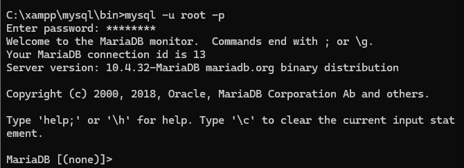
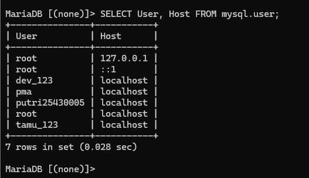
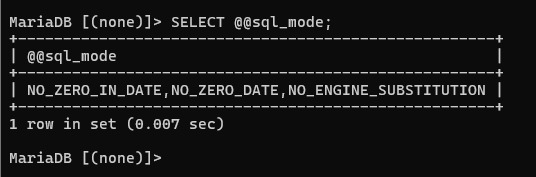
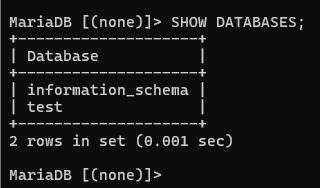
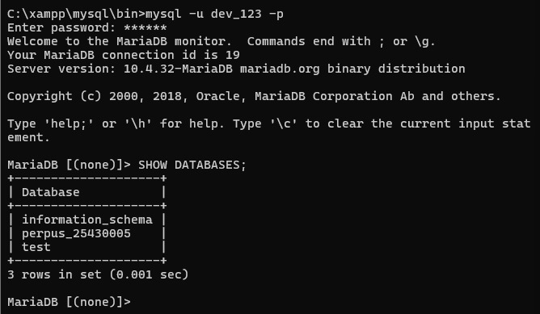
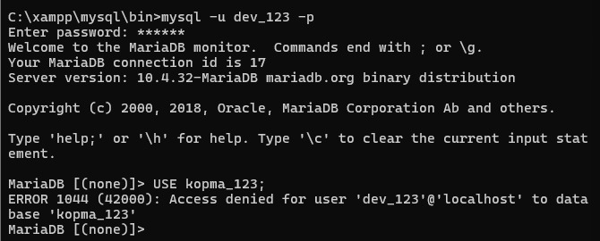
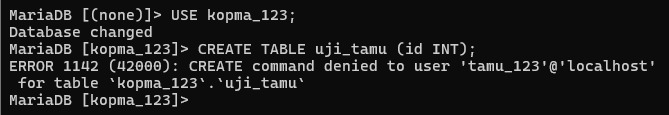

# Laporan Praktikum Basis Data

## Modul 1: Lingkungan Kerja

- Nama: Putri Nur Rahma Dewi
- NIM: 25430005
- Mata Kuliah: Basis Data
- Semester: 3
- Kelas: A

---

## 1. Tujuan Praktikum

Praktikum Modul 1 bertujuan untuk memahami lingkungan kerja basis data menggunakan MySQL/MariaDB melalui XAMPP, melakukan pengaturan akun dan hak akses pengguna, serta menerapkan penggunaan database secara aman dan terstruktur.

Selain itu, praktikum ini bertujuan untuk memahami penggunaan Git dan GitHub sebagai tempat penyimpanan serta pengelolaan file praktikum.

---

## 2. Lingkungan Kerja

Praktikum dilakukan menggunakan perangkat dan perangkat lunak berikut:

- Sistem Operasi: Windows
- XAMPP
- MariaDB/MySQL
- phpMyAdmin
- Command Prompt (CMD)
- Visual Studio Code
- Git
- GitHub

Database yang digunakan dalam praktikum utama adalah `kopma_123`. Database untuk proyek individu adalah `perpus_25430005`. Tema proyek individu adalah **Perpustakaan**.

---

## 3. Pemeriksaan Versi MariaDB

Pemeriksaan versi dilakukan melalui Command Prompt dengan menjalankan MariaDB menggunakan akun root.

Perintah yang digunakan:

```sql
SELECT VERSION();
```

Hasil pemeriksaan menunjukkan bahwa versi MariaDB yang digunakan adalah **10.4.32-MariaDB**. Hal ini menunjukkan bahwa lingkungan basis data telah berhasil dijalankan dan dapat digunakan untuk praktikum.

## 4. Pembuatan Database dan Pengguna

Database utama praktikum dibuat dengan nama `kopma_123`. Database tersebut digunakan sebagai lingkungan kerja untuk melakukan pengujian pembuatan tabel, pemberian hak akses, dan pengujian keamanan pengguna.

Pada praktikum juga dibuat beberapa akun dengan hak akses yang berbeda, yaitu:

- `mhs_123` sebagai pengguna yang memiliki hak akses penuh terhadap database `kopma_123`.
- `tamu_123` sebagai pengguna yang hanya memiliki hak akses SELECT terhadap database `kopma_123`.
- `dev_123` sebagai pengguna untuk database proyek individu `perpus_25430005`.

Pemberian hak akses dilakukan agar setiap pengguna hanya dapat melakukan aktivitas sesuai dengan kebutuhan dan tanggung jawabnya.

---

## 5. Pengujian Hak Akses Pengguna

### 5.1 Pengguna mhs_123

Pengguna `mhs_123` diberikan hak akses penuh terhadap database `kopma_123`. Pengujian dilakukan dengan menjalankan:

```sql
SHOW DATABASES;
```

Hasilnya menunjukkan bahwa database `kopma_123` dapat diakses oleh pengguna `mhs_123`. Dengan demikian, pemberian hak akses terhadap database telah berhasil.

### 5.2 Pengguna tamu_123

Pengguna `tamu_123` diberikan hak akses SELECT pada database `kopma_123`. Pengujian dilakukan dengan mencoba membuat tabel menggunakan perintah:

```sql
CREATE TABLE uji_tamu (id INT);
```

Hasil pengujian menghasilkan:

```
ERROR 1142 (42000): CREATE command denied
```

Hal tersebut menunjukkan bahwa `tamu_123` dapat mengakses data sesuai hak yang diberikan, tetapi tidak memiliki izin untuk membuat tabel.

### 5.3 Pengguna dev_123

Pengguna `dev_123` diberikan hak akses terhadap database proyek `perpus_25430005`. Ketika pengguna `dev_123` mencoba mengakses database `kopma_123`, sistem menghasilkan:

```
ERROR 1044 (42000): Access denied
```

Hal tersebut menunjukkan bahwa `dev_123` tidak memiliki hak akses terhadap database `kopma_123`. Sebaliknya, pengguna `dev_123` dapat mengakses database `perpus_25430005` sesuai dengan hak akses yang diberikan.

---

## 6. Penerapan Idempotensi SQL

Pada praktikum digunakan perintah `IF NOT EXISTS` untuk membuat SQL lebih aman ketika dijalankan berulang kali. Contohnya:

```sql
CREATE DATABASE IF NOT EXISTS kopma_123;

CREATE TABLE IF NOT EXISTS produk (
    id INT PRIMARY KEY,
    nama VARCHAR(100)
);
```

Dengan penggunaan `IF NOT EXISTS`, perintah tidak menyebabkan kesalahan ketika database atau tabel yang dimaksud sudah tersedia. Penerapan ini membuat script SQL lebih aman untuk dijalankan kembali dan mengurangi risiko kegagalan akibat objek database yang sudah dibuat sebelumnya.

## 7. Bukti Tangkapan Layar

### 7.1 Versi MariaDB



*Gambar 1. Hasil `SELECT VERSION();` menunjukkan MariaDB 10.4.32.*

### 7.2 Pembuatan akun



*Gambar 2. Akun `mhs_123`, `tamu_123`, dan `dev_123` pada MariaDB.*

### 7.3 SQL mode



*Gambar 3. Pemeriksaan SQL mode pada server.*

### 7.4 Akses pengguna mhs_123



*Gambar 4. Pengguna `mhs_123` dapat melihat dan mengakses database `kopma_123`.*

### 7.5 Akses pengguna dev_123



*Gambar 5. Pengguna `dev_123` hanya melihat database proyek `perpus_25430005`.*

### 7.6 Pengguna dev_123 (ERROR 1044)



*Gambar 6. `dev_123` ditolak saat mengakses `kopma_123` (ERROR 1044).*

### 7.7 Pengguna tamu_123 (ERROR 1142)



*Gambar 7. `tamu_123` ditolak saat membuat tabel (ERROR 1142).*

### 7.8 phpMyAdmin


*Gambar 8. Halaman login phpMyAdmin.*


*Gambar 9. phpMyAdmin berhasil dibuka dan database dapat diakses.*

### 7.9 GitHub


*Gambar 10. Push pertama berkas praktikum ke repositori GitHub.*

## 8. Analisis Praktikum

### Analisis 1: Hak Akses Pengguna

Hak akses pengguna diperlukan untuk membatasi aktivitas yang dapat dilakukan pada database. Setiap pengguna diberikan hak sesuai dengan kebutuhan tugasnya sehingga keamanan dan pengelolaan data dapat lebih terkontrol.

Dalam praktikum ini, `mhs_123` memiliki hak akses penuh pada database `kopma_123`, sedangkan `tamu_123` hanya diberikan hak SELECT. Perbedaan tersebut menunjukkan bahwa hak akses dapat diberikan secara spesifik kepada setiap pengguna.

### Analisis 2: Perbedaan Hak Akses

Perbedaan hak akses dapat dilihat dari kemampuan pengguna dalam menjalankan perintah SQL. `mhs_123` dapat melakukan operasi pada database `kopma_123` sesuai hak akses penuh yang diberikan.

Sementara itu, `tamu_123` hanya dapat melakukan operasi SELECT sehingga tidak dapat membuat tabel baru. Ketika mencoba menjalankan perintah CREATE TABLE, sistem menghasilkan ERROR 1142. Pembagian hak akses seperti ini membantu mencegah pengguna melakukan perubahan yang tidak sesuai dengan kewenangannya.

### Analisis 3: Idempotensi SQL

Idempotensi SQL berarti sebuah script dapat dijalankan kembali tanpa menyebabkan kesalahan karena objek database atau tabel sudah tersedia. Kata `IF NOT EXISTS` membuat perintah memeriksa terlebih dahulu apakah objek sudah tersedia. Jika sudah ada, sistem tidak membuat objek yang sama kembali.

Penerapan idempotensi membuat script lebih aman, mudah digunakan kembali, dan mengurangi kesalahan saat proses instalasi atau pengujian database.

### Analisis 4: Perbedaan ERROR 1044, 1045, dan 1142

Ketiga error tersebut menunjukkan masalah yang berbeda.

**ERROR 1044** terjadi ketika pengguna berhasil dikenali oleh sistem, tetapi tidak memiliki izin untuk mengakses database tertentu. Dalam praktikum, `dev_123` mendapatkan ERROR 1044 ketika mencoba mengakses `kopma_123`.

**ERROR 1045** terjadi ketika proses autentikasi atau login gagal, misalnya karena username atau password tidak sesuai.

**ERROR 1142** terjadi ketika pengguna sudah berhasil login dan dapat mengakses database, tetapi tidak memiliki izin untuk menjalankan perintah tertentu. Dalam praktikum, `tamu_123` mendapatkan ERROR 1142 ketika mencoba membuat tabel karena hanya memiliki hak SELECT.

| Error | Penyebab |
|---|---|
| 1044 | Tidak memiliki akses ke database tertentu |
| 1045 | Gagal melakukan autentikasi/login |
| 1142 | Tidak memiliki izin menjalankan perintah tertentu |

---

## 9. Hasil Praktikum

Berdasarkan praktikum yang telah dilakukan, lingkungan kerja MariaDB berhasil dijalankan melalui XAMPP. Database `kopma_123` berhasil dibuat dan pengguna dengan hak akses berbeda berhasil dikonfigurasi.

Pengujian juga membuktikan bahwa pembatasan hak akses berjalan sesuai dengan konfigurasi. Pengguna `mhs_123` dapat mengakses database `kopma_123`, sedangkan `tamu_123` hanya dapat melakukan SELECT. Pengguna `dev_123` hanya diberikan akses pada database proyek `perpus_25430005`. Selain itu, penggunaan `IF NOT EXISTS` berhasil diterapkan untuk membuat script SQL yang aman dijalankan kembali.

---

## 10. Kesimpulan

Praktikum Modul 1 memberikan pemahaman mengenai pengelolaan lingkungan kerja database menggunakan MariaDB, pembuatan database dan pengguna, serta pemberian hak akses berdasarkan kebutuhan.

Melalui pengujian beberapa akun, dapat dipahami bahwa hak akses berpengaruh terhadap perintah SQL yang dapat dijalankan oleh pengguna. Praktikum juga menunjukkan pentingnya penggunaan idempotensi pada script SQL agar dapat dijalankan kembali dengan lebih aman. Penggunaan Git dan GitHub juga membantu menyimpan serta mengelola hasil praktikum secara terstruktur.

---

## 11. Bukti Git

## 11. Bukti Git

- **Repositori:** [https://github.com/putriid990-ai/basisdata-25430005](https://github.com/putriid990-ai/basisdata-25430005)

Riwayat commit yang digunakan sebagai bukti pengerjaan Modul 1 adalah sebagai berikut.

| Hash commit | Pesan commit |
|---|---|
| `ecd9128` | `Lengkapi Modul 1` |

## Checklist

| Status | Jenis | Yang harus ada |
|---|---|---|
| [√] | Berkas wajib | `p01_lingkungan_25430005.sql` |
| [√] | Bukti tangkapan layar | Versi MariaDB; akun; SQL mode; akses `mhs_123` dan `dev_123`; ERROR 1044 (`dev_123`); ERROR 1142 (`tamu_123`); phpMyAdmin; push pertama ke GitHub |
| [√] | Analisis wajib | Hak akses pengguna; perbedaan hak akses; idempotensi SQL; perbedaan ERROR 1044, 1045, dan 1142 |
