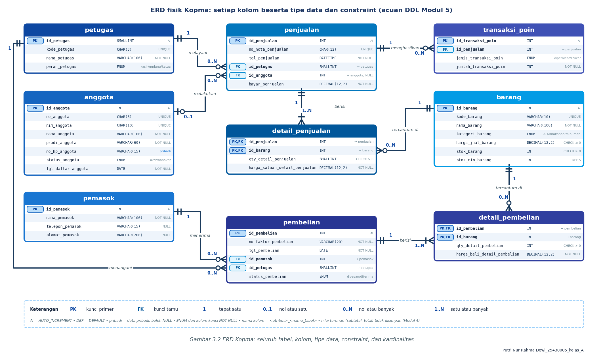
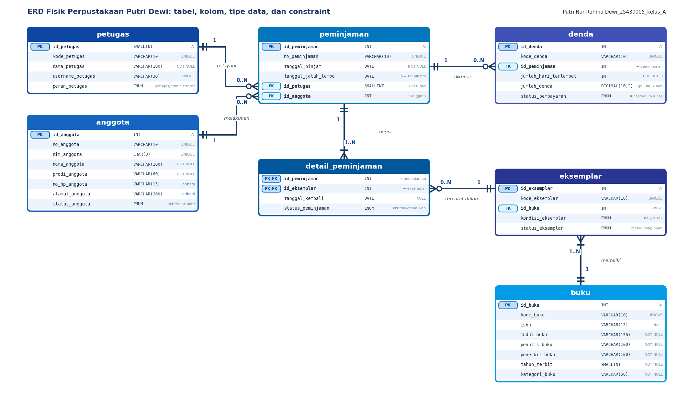

# Laporan Praktikum Basis Data

## ERD Fisik Kopma (Koperasi Mahasiswa)

Acuan DDL Modul 5

**Disusun oleh:** Putri Nur Rahma Dewi  
**NIM:** 25430005  
**Kelas:** A

---

## 1. Pendahuluan

### 1.1 Latar Belakang

Koperasi Mahasiswa (Kopma) menjalankan kegiatan jual beli barang kebutuhan mahasiswa, seperti alat tulis, makanan, dan minuman. Kegiatan ini melibatkan banyak data yang saling berkaitan: anggota yang berbelanja, petugas yang melayani, barang yang dijual, dan pemasok yang memasok barang. Tanpa rancangan basis data yang baik, data tersebut sulit dikelola dan rawan tidak konsisten.

Entity Relationship Diagram (ERD) fisik digunakan sebagai rancangan sebelum membuat tabel dengan perintah DDL. Pada ERD fisik, setiap tabel digambarkan lengkap dengan nama kolom, tipe data, dan constraint, sehingga bisa langsung diterjemahkan ke dalam perintah `CREATE TABLE`.

### 1.2 Tujuan

1. Menggambarkan struktur basis data Kopma dalam bentuk ERD fisik.
2. Menjelaskan setiap tabel beserta kolom, tipe data, dan constraint-nya.
3. Menjelaskan relasi antartabel beserta kardinalitasnya.
4. Menunjukkan bahwa rancangan dapat menjawab kebutuhan informasi (KI-01 sampai KI-06).

## 2. Gambaran Umum Rancangan

ERD Kopma terdiri dari 9 tabel yang dikelompokkan menjadi empat bagian.

| Kelompok | Tabel | Fungsi |
|---|---|---|
| Data master | petugas, anggota, pemasok, barang | Menyimpan data pokok yang jarang berubah |
| Transaksi | penjualan, pembelian | Menyimpan nota penjualan dan faktur pembelian (data header) |
| Detail transaksi | detail_penjualan, detail_pembelian | Menyimpan barang pada setiap nota atau faktur |
| Poin anggota | transaksi_poin | Mencatat poin yang diperoleh dan ditukar anggota |

*Gambar 3.2 ERD Kopma: seluruh tabel, kolom, tipe data, constraint, dan kardinalitas*

## 3. Kamus Data

Keterangan singkatan: PK = kunci primer, FK = kunci tamu, AI = AUTO_INCREMENT, DEF = DEFAULT.

### 3.1 Tabel petugas

Menyimpan data petugas Kopma yang melayani penjualan dan menangani pembelian.

| Kolom | Tipe data | Constraint | Keterangan |
|---|---|---|---|
| id_petugas | SMALLINT | PK, AI | Identitas petugas |
| kode_petugas | CHAR(3) | UNIQUE | Kode singkat petugas |
| nama_petugas | VARCHAR(100) | NOT NULL | Nama lengkap petugas |
| peran_petugas | ENUM | NOT NULL | kasir, gudang, atau ketua |

### 3.2 Tabel anggota

Menyimpan data anggota Kopma.

| Kolom | Tipe data | Constraint | Keterangan |
|---|---|---|---|
| id_anggota | INT | PK, AI | Identitas anggota |
| no_anggota | CHAR(6) | UNIQUE | Nomor anggota |
| nim_anggota | CHAR(10) | UNIQUE | NIM anggota |
| nama_anggota | VARCHAR(100) | NOT NULL | Nama lengkap anggota |
| prodi_anggota | VARCHAR(60) | NOT NULL | Program studi |
| no_hp_anggota | VARCHAR(15) | NULL | Data pribadi, boleh kosong |
| status_anggota | ENUM | NOT NULL | aktif atau nonaktif |
| tgl_daftar_anggota | DATE | NOT NULL | Tanggal pendaftaran |

### 3.3 Tabel pemasok

Menyimpan data pemasok yang mengirim barang ke Kopma.

| Kolom | Tipe data | Constraint | Keterangan |
|---|---|---|---|
| id_pemasok | INT | PK, AI | Identitas pemasok |
| nama_pemasok | VARCHAR(100) | NOT NULL | Nama pemasok |
| telepon_pemasok | VARCHAR(15) | NULL | Nomor telepon |
| alamat_pemasok | VARCHAR(200) | NULL | Alamat pemasok |

### 3.4 Tabel barang

Menyimpan data barang yang dijual dan stoknya.

| Kolom | Tipe data | Constraint | Keterangan |
|---|---|---|---|
| id_barang | INT | PK, AI | Identitas barang |
| kode_barang | VARCHAR(10) | UNIQUE | Kode barang |
| nama_barang | VARCHAR(100) | NOT NULL | Nama barang |
| kategori_barang | ENUM | NOT NULL | ATK, makanan, atau minuman |
| harga_jual_barang | DECIMAL(12,2) | CHECK >= 0 | Harga jual saat ini |
| stok_barang | INT | CHECK >= 0 | Jumlah stok tersedia |
| stok_min_barang | INT | DEF 5 | Batas stok minimum |

### 3.5 Tabel penjualan

Menyimpan data header nota penjualan.

| Kolom | Tipe data | Constraint | Keterangan |
|---|---|---|---|
| id_penjualan | INT | PK, AI | Identitas penjualan |
| no_nota_penjualan | CHAR(12) | UNIQUE | Nomor nota |
| tgl_penjualan | DATETIME | NOT NULL | Waktu transaksi |
| id_petugas | SMALLINT | FK ke petugas | Petugas yang melayani |
| id_anggota | INT | FK ke anggota, NULL | Kosong jika pembeli bukan anggota |
| bayar_penjualan | DECIMAL(12,2) | NOT NULL | Jumlah uang yang dibayarkan |

### 3.6 Tabel detail_penjualan

Menyimpan barang yang terjual pada setiap nota. Kunci primernya gabungan dari id_penjualan dan id_barang.

| Kolom | Tipe data | Constraint | Keterangan |
|---|---|---|---|
| id_penjualan | INT | PK, FK ke penjualan | Nota penjualan |
| id_barang | INT | PK, FK ke barang | Barang yang dijual |
| qty_detail_penjualan | SMALLINT | CHECK > 0 | Jumlah barang terjual |
| harga_satuan_detail_penjualan | DECIMAL(12,2) | NOT NULL | Harga satuan saat transaksi |

### 3.7 Tabel pembelian

Menyimpan data header faktur pembelian dari pemasok.

| Kolom | Tipe data | Constraint | Keterangan |
|---|---|---|---|
| id_pembelian | INT | PK, AI | Identitas pembelian |
| no_faktur_pembelian | VARCHAR(20) | NOT NULL | Nomor faktur pemasok |
| tgl_pembelian | DATE | NOT NULL | Tanggal pembelian |
| id_pemasok | INT | FK ke pemasok | Pemasok barang |
| id_petugas | SMALLINT | FK ke petugas | Petugas yang menangani |
| status_pembelian | ENUM | NOT NULL | dipesan atau diterima |

### 3.8 Tabel detail_pembelian

Menyimpan barang yang dibeli pada setiap faktur. Kunci primernya gabungan dari id_pembelian dan id_barang.

| Kolom | Tipe data | Constraint | Keterangan |
|---|---|---|---|
| id_pembelian | INT | PK, FK ke pembelian | Faktur pembelian |
| id_barang | INT | PK, FK ke barang | Barang yang dibeli |
| qty_detail_pembelian | INT | CHECK > 0 | Jumlah barang dibeli |
| harga_beli_detail_pembelian | DECIMAL(12,2) | NOT NULL | Harga beli satuan |

### 3.9 Tabel transaksi_poin

Mencatat poin yang diperoleh dari penjualan dan poin yang ditukar oleh anggota.

| Kolom | Tipe data | Constraint | Keterangan |
|---|---|---|---|
| id_transaksi_poin | INT | PK, AI | Identitas transaksi poin |
| id_penjualan | INT | FK ke penjualan | Penjualan yang terkait |
| jenis_transaksi_poin | ENUM | NOT NULL | diperoleh atau ditukar |
| jumlah_transaksi_poin | INT | NOT NULL | Banyaknya poin |

*Catatan: pada rancangan awal, tabel transaksi_poin belum mencantumkan tipe data dan constraint. Tipe data pada tabel di atas merupakan asumsi penulis yang disesuaikan dengan kebutuhan KI-05 dan KI-06, sehingga perlu disesuaikan dengan DDL yang dipakai.*

## 4. Relasi dan Kardinalitas

Notasi yang dipakai adalah crow's foot: 1 berarti tepat satu, 0..1 nol atau satu, 0..N nol atau banyak, dan 1..N satu atau banyak.

| No | Tabel asal | Relasi | Tabel tujuan | Kardinalitas | Penjelasan |
|---|---|---|---|---|---|
| 1 | petugas | melayani | penjualan | 1 : 0..N | Satu petugas dapat melayani banyak penjualan, setiap penjualan dilayani tepat satu petugas |
| 2 | anggota | melakukan | penjualan | 0..1 : 0..N | Satu anggota dapat berbelanja berkali-kali. Penjualan boleh tanpa anggota (pembeli umum) |
| 3 | penjualan | berisi | detail_penjualan | 1 : 1..N | Setiap nota memuat minimal satu barang |
| 4 | barang | tercantum di | detail_penjualan | 1 : 0..N | Satu barang dapat muncul di banyak nota |
| 5 | pemasok | menerima | pembelian | 1 : 0..N | Satu pemasok dapat memiliki banyak faktur pembelian |
| 6 | petugas | menangani | pembelian | 1 : 0..N | Satu petugas dapat menangani banyak pembelian |
| 7 | pembelian | berisi | detail_pembelian | 1 : 1..N | Setiap faktur memuat minimal satu barang |
| 8 | barang | tercantum di | detail_pembelian | 1 : 0..N | Satu barang dapat dibeli berkali-kali |
| 9 | penjualan | menghasilkan | transaksi_poin | 1 : 0..N | Satu penjualan dapat menghasilkan catatan poin |

Relasi banyak ke banyak antara penjualan dan barang dipecah menjadi tabel detail_penjualan. Hal yang sama berlaku untuk pembelian dan barang melalui detail_pembelian. Pemecahan ini membuat setiap tabel detail memiliki kunci primer gabungan.

## 5. Penelusuran Kebutuhan Informasi ke Jalur ERD

Rancangan diuji dengan menelusuri apakah setiap kebutuhan informasi (KI) dapat dijawab melalui jalur tabel yang saling berelasi.

| KI | Kebutuhan informasi | Jalur tabel pada ERD |
|---|---|---|
| KI-01 | Omzet dan jumlah nota per hari atau bulan | penjualan, detail_penjualan |
| KI-02 | Lima barang terlaris per bulan | barang, detail_penjualan, penjualan |
| KI-03 | Barang di bawah stok minimum | barang |
| KI-04 | Sepuluh anggota dengan belanja terbesar | anggota, penjualan, detail_penjualan |
| KI-05 | Poin diperoleh dan ditukar per bulan | anggota, penjualan, transaksi_poin |
| KI-06 | Sepuluh anggota dengan poin terbanyak | anggota, penjualan, transaksi_poin |

Semua KI dapat dijawab melalui relasi yang sudah ada. KI-03 cukup memakai satu tabel, yaitu membandingkan kolom stok_barang dengan stok_min_barang.

## 6. Keputusan Desain

1. Nama kolom konsisten. Nama kolom mengikuti pola `<atribut>_<nama_tabel>`, misalnya nama_petugas dan tgl_penjualan. Kolom kunci memakai nama yang sama di tabel asal dan tabel tujuan.
2. Nilai turunan tidak disimpan. Subtotal dan total tidak disimpan di tabel, karena dapat dihitung dari qty dan harga satuan pada tabel detail (sesuai Modul 4). Cara ini mencegah data total berbeda dengan rinciannya.
3. Harga transaksi disimpan di tabel detail. Harga satuan pada detail_penjualan dan detail_pembelian merekam harga saat transaksi terjadi, sehingga perubahan harga di tabel barang tidak mengubah nota lama.
4. Data pribadi boleh NULL. Kolom no_hp_anggota, telepon_pemasok, dan alamat_pemasok dapat dikosongkan karena tidak wajib.
5. Pembeli umum didukung. id_anggota pada penjualan boleh NULL, sehingga penjualan kepada non-anggota tetap bisa dicatat.
6. Validasi lewat CHECK dan ENUM. Jumlah barang harus lebih dari 0, harga dan stok tidak boleh negatif, dan nilai seperti peran, status, serta kategori dibatasi dengan ENUM agar isinya seragam.
7. Nilai bawaan stok minimum. stok_min_barang bernilai 5 secara bawaan sehingga tidak perlu diisi untuk setiap barang.

## 7. Kesimpulan

ERD fisik Kopma terdiri dari 9 tabel yang saling berelasi: empat tabel master, dua tabel transaksi, dua tabel detail, dan satu tabel poin anggota. Setiap kolom sudah memiliki tipe data dan constraint sehingga rancangan siap diterjemahkan ke DDL pada Modul 5. Penelusuran KI-01 sampai KI-06 menunjukkan bahwa rancangan dapat menjawab seluruh kebutuhan informasi koperasi. Hal yang masih perlu dicocokkan adalah tipe data tabel transaksi_poin, karena bagian itu disusun berdasarkan asumsi.

---

## 8. Bukti Tangkapan Layar

### 8.1 ERD Kopma

*Gambar 1. ERD fisik Kopma (9 tabel) dengan tipe data, constraint, dan kardinalitas.*

### 8.2 ERD proyek perpustakaan

*Gambar 2. ERD fisik proyek Perpustakaan Putri Dewi (7 tabel).*

---

## 9. Bukti Git

- **Repositori:** https://github.com/putriid990-ai/basisdata-25430005

Riwayat commit yang digunakan sebagai bukti pengerjaan Modul 3 adalah sebagai berikut.

| Hash commit | Pesan commit |
|---|---|
| 186b4fb | `(Tambah laporan dan dokumentasi ERD Modul 3)` |
| 7ecbd16 | `(Tambah ERD Perpustakaan Putri Dewi)` |
| 0c34aa3 | `(Tambah ERD Perpustakaan Putri Dewi)` |

## Checklist

| Status | Jenis | Yang harus ada |
|---|---|---|
| [√] | Berkas wajib | `p03_erd_kopma_25430005.drawio` dan `p03_erd_perpustakaan_25430005.drawio` |
| [√] | Bukti tangkapan layar | ERD Kopma dan ERD proyek perpustakaan |
| [√] | Analisis wajib | Kamus data, relasi dan kardinalitas, penelusuran KI-01 sampai KI-06, dan keputusan desain |
