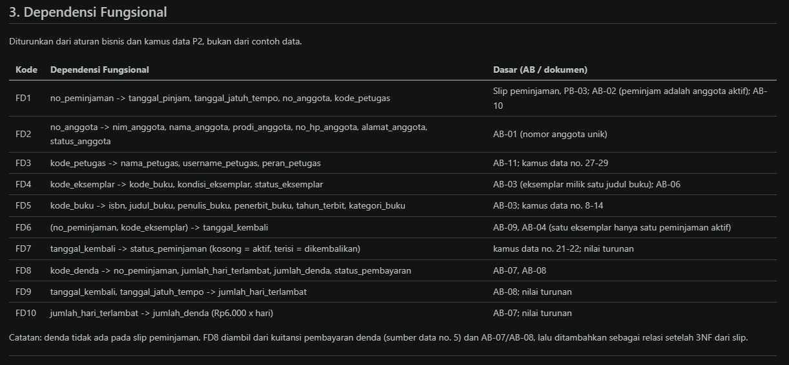
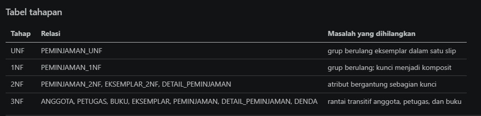
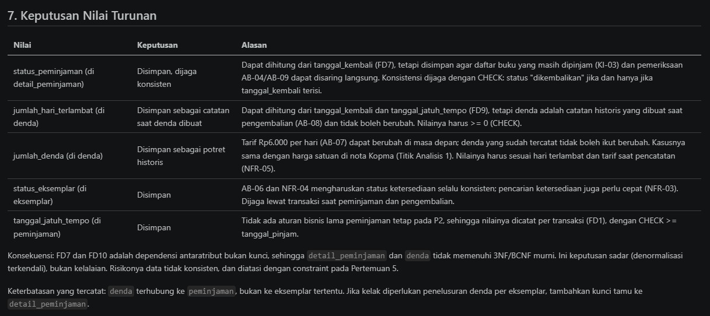
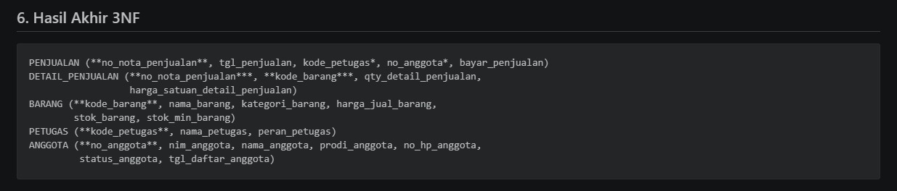

# Laporan Praktikum Basis Data - Pertemuan 4: Normalisasi dan Skema Relasional

- Nama: Putri Nur Rahma Dewi
- NIM: 25430005
- Kelas: A
- Mata Kuliah: Basis Data (Semester 3)

---

## 1. Tujuan

1. Mengidentifikasi anomali ubah, sisip, dan hapus pada data yang belum dinormalisasi.
2. Menuliskan dependensi fungsional dari aturan bisnis.
3. Menormalisasi relasi hingga 3NF dan memeriksa BCNF.
4. Memutuskan penyimpanan nilai turunan dan mendokumentasikan skema relasional akhir.

## 2. Alat dan Bahan

- Spreadsheet lama Kopma pada modul.
- ERD Kopma dan ERD proyek dari Pertemuan 3.
- Editor Markdown dan repositori `basisdata-25430005`.

## 3. Ringkasan Langkah Percobaan Kopma

Pada latihan Kopma, saya mulai dari bentuk UNF nota penjualan, yaitu satu nota yang menyimpan grup berulang barang. Grup itu saya pecah menjadi satu baris per barang per nota sehingga menjadi 1NF dengan kunci komposit (no_nota_penjualan, kode_barang).

Setelah itu saya menuliskan dependensi fungsional FD1 sampai FD6 dari aturan bisnis, bukan dari isi spreadsheet. Pada tahap 2NF, atribut yang hanya bergantung pada sebagian kunci saya pisahkan menjadi `penjualan` dan `barang`, sedangkan sisanya menjadi `detail_penjualan`. Pada tahap 3NF, rantai nota ke petugas dan nota ke anggota saya pisahkan menjadi `petugas` dan `anggota`.

Nilai turunan (subtotal, jumlah, dan total penjualan) tidak disimpan di tabel operasional agar tidak mungkin tidak konsisten. Hasil akhirnya lima relasi, dicocokkan dengan skema kanonik yang memakai kunci pengganti `id_*`, lalu diperiksa BCNF dan semuanya memenuhi. Detail lengkap ada di `p04_normalisasi_kopma_25430005.md`.

## 4. Milestone Proyek 4: Normalisasi Perpustakaan

Dokumen sumber proyek adalah Slip Peminjaman Perpustakaan Putri Dewi dari Pertemuan 2. Satu slip dapat memuat beberapa eksemplar (maksimal 8, AB-05), sehingga eksemplar menjadi grup berulang pada UNF. Kunci 1NF-nya adalah (no_peminjaman, kode_eksemplar).

Saya menuliskan sepuluh dependensi fungsional (FD1 sampai FD10) beserta kode AB atau kamus data yang mendasarinya, misalnya AB-01 untuk nomor anggota unik, AB-03 untuk hubungan buku dan eksemplar, serta AB-07 dan AB-08 untuk denda. Pada 2NF, atribut dipisah menurut bagian kunci yang menentukannya. Pada 3NF, `anggota`, `petugas`, dan `buku` dipisah dari tabel transaksi. Hasil akhirnya tujuh relasi: anggota, petugas, buku, eksemplar, peminjaman, detail_peminjaman, dan denda.

Pemeriksaan BCNF menunjukkan lima tabel memenuhi BCNF, sedangkan `detail_peminjaman` dan `denda` memiliki penentu yang bukan kunci kandidat karena menyimpan nilai turunan. Keduanya sengaja dipertahankan sesuai ERD (lihat bagian 6.3). ERD Pertemuan 3 sudah memakai kunci pengganti `id_*` dan cocok dengan hasil 3NF, sehingga tidak ada perubahan struktur ERD. Detail lengkap ada di `p04_normalisasi_25430005.md`.

## 5. Bukti Tangkapan Layar

### 5.1 Daftar dependensi fungsional



*Gambar 1. Daftar FD proyek (FD1 sampai FD10) beserta kode AB yang mendasarinya.*

### 5.2 Tabel tahapan UNF ke 1NF ke 2NF ke 3NF



*Gambar 2. Tahapan normalisasi proyek perpustakaan dari UNF sampai 3NF.*

### 5.3 Keputusan nilai turunan



*Gambar 3. Keputusan menyimpan atau menghitung nilai turunan beserta alasannya.*

### 5.4 Hasil normalisasi Kopma



*Gambar 4. Hasil akhir 3NF Kopma.*

## 6. Analisis

### 6.1 Titik Analisis

**Titik Analisis 1.** Harga satuan ditempatkan pada kunci (no_nota_penjualan, kode_barang) karena aturan AB-04 menyatakan harga di nota bisa berbeda dari harga barang saat ini. Harga di nota adalah harga pada saat transaksi terjadi. Jika harga dipindah ke tabel barang, setiap perubahan harga hari ini akan ikut mengubah nilai transaksi lama, sehingga laporan omzet tahun lalu menjadi salah.

**Titik Analisis 2.** Pada tabel operasional, data masih bisa berubah, jadi total lebih aman dihitung dari detailnya agar selalu konsisten. Pada tabel arsip, data adalah potret historis yang tidak boleh berubah, sehingga total sengaja disimpan. Kedua keputusan itu konsisten karena tujuannya sama, yaitu menjaga angka tetap benar sesuai fungsi tabelnya.

**Titik Analisis 3.** Informasi "barang ini dipasok oleh siapa" kini disimpan melalui tabel `pembelian` (memuat id_pemasok) dan `detail_pembelian` (memuat id_barang). Keuntungannya, satu barang dapat dipasok banyak pemasok, riwayat pembelian setiap pemasok tercatat, dan nama pemasok hanya disimpan sekali sehingga tidak ada lagi ejaan yang berubah-ubah.

### 6.2 Latihan dan Modifikasi

**Latihan 1.** Satu pemasok dapat memiliki banyak nomor telepon. Menyimpannya sebagai daftar dalam satu kolom melanggar 1NF, jadi dibuat relasi baru:
`TELEPON_PEMASOK (id_telepon_pemasok, id_pemasok*, no_telepon_pemasok)` dengan UNIQUE (id_pemasok, no_telepon_pemasok).

**Latihan 2.** Jika `nama_anggota` disimpan di tabel penjualan, terjadi rantai no_nota_penjualan -> no_anggota -> nama_anggota, sehingga melanggar 3NF. Contohnya anggota A-01 muncul di tiga nota (N-001, N-002, N-003) dengan nama yang sama. Kueri berikut hanya mengubah satu nota:

```sql
UPDATE penjualan_salah
SET nama_anggota = 'Budi S. Santoso'
WHERE no_nota_penjualan = 'N-001';

SELECT DISTINCT no_anggota, nama_anggota
FROM penjualan_salah
WHERE no_anggota = 'A-01';
```

Hasilnya anggota A-01 muncul dengan dua nama berbeda. Itulah anomali ubah, karena satu fakta tersimpan di banyak baris dan tidak ikut berubah bersamaan.

### 6.3 Alasan keputusan nilai turunan proyek

Empat nilai turunan pada ERD proyek tetap disimpan dengan alasan masing-masing:

- **status_peminjaman** dapat dihitung dari `tanggal_kembali`, tetapi disimpan agar daftar buku yang masih dipinjam dan pemeriksaan AB-04/AB-09 bisa disaring langsung. Konsistensinya dijaga dengan CHECK: status "dikembalikan" jika dan hanya jika `tanggal_kembali` terisi.
- **jumlah_hari_terlambat** dapat dihitung dari `tanggal_kembali` dan `tanggal_jatuh_tempo`, tetapi denda adalah catatan historis yang dibuat saat pengembalian (AB-08) sehingga tidak boleh berubah. Nilainya dijaga dengan CHECK >= 0.
- **jumlah_denda** disimpan sebagai potret historis karena tarif Rp6.000 per hari (AB-07) bisa berubah di masa depan. Kasusnya sama dengan harga satuan pada nota Kopma. Nilainya harus sesuai hari terlambat dan tarif saat pencatatan (NFR-05).
- **status_eksemplar** disimpan karena AB-06 dan NFR-04 mengharuskan status ketersediaan selalu konsisten, dan pencarian ketersediaan harus cepat (NFR-03). Konsistensinya dijaga lewat transaksi saat peminjaman dan pengembalian.

Akibatnya `detail_peminjaman` dan `denda` tidak memenuhi 3NF/BCNF murni. Ini denormalisasi terkendali, dan risiko data tidak konsisten ditangani dengan constraint pada Pertemuan 5.

## 7. Masalah yang Dihadapi dan Solusinya

1. **Skema relasional tampil berantakan.** Skema yang ditulis di dalam blok kode menampilkan tanda `**` mentah dan barisnya terpotong. Solusinya, skema ditulis sebagai teks biasa satu relasi per baris sehingga tanda kunci primer tampil tebal.
2. **Hasil normalisasi tidak sepenuhnya cocok dengan ERD.** Saat ERD diuji, `status_peminjaman`, `jumlah_hari_terlambat`, dan `jumlah_denda` ternyata nilai turunan yang tetap disimpan, sehingga dua tabel tidak BCNF. Solusinya, keputusan itu dicatat sebagai denormalisasi terkendali beserta alasan dan constraint penjagaannya, tanpa mengubah ERD.
3. **Denda tidak terhubung ke eksemplar tertentu.** Pada ERD, `denda` terhubung ke `peminjaman`, padahal pengembalian dicatat per eksemplar. Solusinya, hal ini dicatat sebagai keterbatasan, dan kunci tamu ke `detail_peminjaman` dapat ditambahkan jika diperlukan.
4. **Lama peminjaman tidak punya aturan bisnis.** Slip menunjukkan tujuh hari, tetapi tidak ada AB yang menyebutnya. Solusinya, `tanggal_jatuh_tempo` disimpan per transaksi dengan CHECK >= tanggal_pinjam.
5. **Gambar bukti tidak muncul di laporan.** Laporan berada di folder `laporan/` sedangkan gambar di folder `bukti/`. Solusinya, jalur gambar ditulis `../bukti/nama_file.png` dan nama file disamakan persis.

## 8. Kesimpulan

Normalisasi terbukti menjadi alat uji yang berguna bagi ERD. Pada Kopma, tahapan UNF sampai 3NF menghasilkan lima relasi yang bebas dari anomali ubah, sisip, dan hapus. Pada proyek perpustakaan, tujuh relasi hasil 3NF cocok dengan ERD Pertemuan 3, dengan dua pengecualian terkendali pada nilai turunan yang sengaja disimpan.

Dependensi fungsional harus diturunkan dari aturan bisnis, bukan dari contoh data, dan keputusan menyimpan atau menghitung nilai turunan perlu alasan yang jelas. Kunci pengganti `id_*` tidak menggantikan pemeriksaan dengan kunci alami. Hasil dokumen ini siap menjadi dasar skrip DDL pada Pertemuan 5.

## 9. Kaitan dengan Pertemuan 5

Skema 3NF proyek menjadi dasar skrip DDL pada Pertemuan 5. Setiap kunci dan aturan pada dokumen normalisasi harus muncul sebagai constraint.

---

## 10. Bukti Git

- **Repositori:** https://github.com/putriid990-ai/basisdata-25430005

Riwayat commit yang digunakan sebagai bukti pengerjaan Milestone Proyek 4 adalah sebagai berikut.

| Hash commit | Pesan commit |
|---|---|
| `cd67c11` | `p04: normalisasi kopma` |
| `30221ae` | `p04: normalisasi perpustakaan` |
| `7ac05ea` | `p04: laporan dan bukti` |

## Checklist

| Status | Jenis | Yang harus ada |
|---|---|---|
| [√] | Berkas wajib | `p04_normalisasi_25430005.md` (proyek) dan `p04_normalisasi_kopma_25430005.md` |
| [√] | Bukti tangkapan layar | Daftar dependensi fungsional; keputusan menyimpan atau menghitung nilai turunan beserta alasannya; tabel tahapan UNF → 1NF → 2NF → 3NF |
| [√] | Analisis wajib | Dokumen sumber, dependensi fungsional, dan keputusan nilai turunan proyek berasal dari aturan bisnis sendiri |
