# Laporan Praktikum Basis Data - Pertemuan 5: Membangun Struktur dengan DDL dan Constraint

- Nama: Putri Nur Rahma Dewi
- NIM: 25430005
- Kelas: A
- Mata Kuliah: Basis Data (Semester 3)

---

## 1. Tujuan

1. Menerjemahkan skema relasional 3NF menjadi perintah CREATE TABLE dengan tipe data yang tepat.
2. Menerapkan constraint PRIMARY KEY, FOREIGN KEY, UNIQUE, NOT NULL, DEFAULT, dan CHECK sesuai aturan bisnis.
3. Mengubah dan menghapus struktur dengan ALTER TABLE dan DROP TABLE dalam urutan yang benar.
4. Membuktikan bahwa constraint menolak data yang melanggar aturan, lalu membandingkan desain fisik dengan ERD.

## 2. Alat dan Bahan

- XAMPP 8.2.12 (MariaDB 10.4.32) dan phpMyAdmin (termasuk menu Desainer).
- Basis data `kopma_123` (latihan Kopma) dan `perpus_25430005` (proyek perpustakaan).
- Dokumen normalisasi dan ERD dari Pertemuan 3 dan 4.
- Editor teks untuk menulis berkas `.sql`, dan draw.io untuk ERD fisik.

## 3. Ringkasan Langkah Percobaan Kopma

Pada latihan Kopma, saya menulis `p05_ddl_kopma_25430005.sql` yang berisi delapan tabel: petugas, anggota, barang, pemasok, penjualan, detail_penjualan, pembelian, dan detail_pembelian. Tabel induk dibuat lebih dulu, baru tabel anak yang memakai kunci tamu. Di awal skrip ada `DROP TABLE IF EXISTS` dengan urutan terbalik (anak ke induk) agar skrip dapat dijalankan ulang dari basis data kosong.

Setelah tabel terbentuk, saya mengisi data induk (dua petugas dan dua barang), lalu membuktikan constraint bekerja dengan tiga perintah yang harus ditolak: kunci tamu tidak dikenal (galat 1452), stok negatif (galat 4025, AB-03), dan kode barang kembar (galat 1062). Saya juga memeriksa hasilnya dengan `SHOW TABLES` dan `SHOW CREATE TABLE penjualan`, lalu membandingkan desain fisik dengan ERD melalui menu Desainer. Skrip lengkap ada di `p05_ddl_kopma_25430005.sql`.

## 4. Milestone Proyek 5: DDL Perpustakaan

Pada proyek perpustakaan, saya menulis `p05_ddl_25430005.sql` untuk tujuh tabel hasil normalisasi Pertemuan 4: petugas, anggota, buku, eksemplar, peminjaman, detail_peminjaman, dan denda. Setiap tabel memiliki kunci primer pengganti `id_*`, sedangkan kode alami seperti `no_anggota`, `kode_buku`, `kode_eksemplar`, `no_peminjaman`, dan `kode_denda` menjadi kunci unik. Setiap relasi ERD menjadi kunci tamu, dan semua constraint diberi komentar kode AB-xx. Nama constraint mengikuti pola `pk_`, `fk_`, `uq_`, dan `ck_` ditambah nama tabel.

Skrip diawali `DROP TABLE IF EXISTS` urutan anak ke induk sehingga dapat dijalankan ulang. Aturan yang menyangkut banyak baris atau tabel lain tidak dapat dijaga CHECK, sehingga ditandai untuk Modul 14 (lihat bagian 6.4). ERD fisik proyek digambar di `p05_erd_fisik_25430005.drawio` dan diekspor sebagai `p05_erd_fisik_25430005.png`.

## 5. Bukti Tangkapan Layar

### 5.1 Kopma (`kopma_123`)

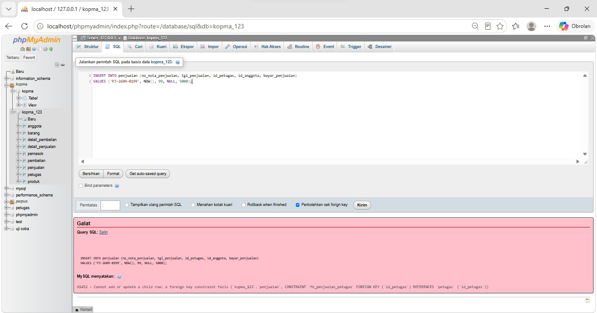

*Gambar 1. Galat 1452: nota dengan id_petugas 99 ditolak oleh `fk_penjualan_petugas`.*

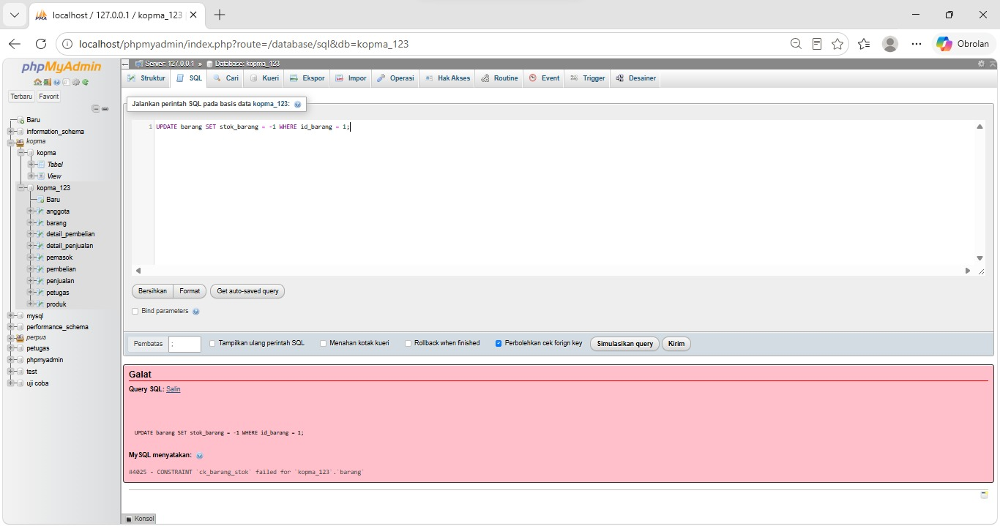

*Gambar 2. Galat 4025: stok -1 ditolak oleh `ck_barang_stok` (AB-03).*

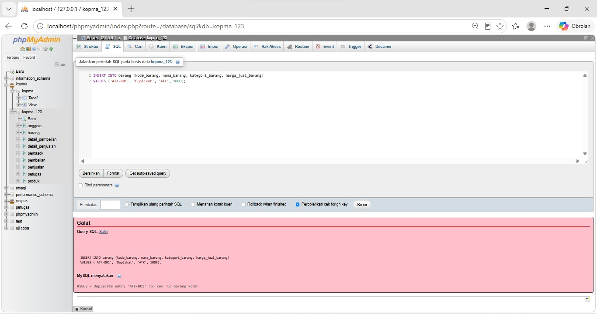

*Gambar 3. Galat 1062: kode barang ATK-001 kembar ditolak oleh `uq_barang_kode`.*

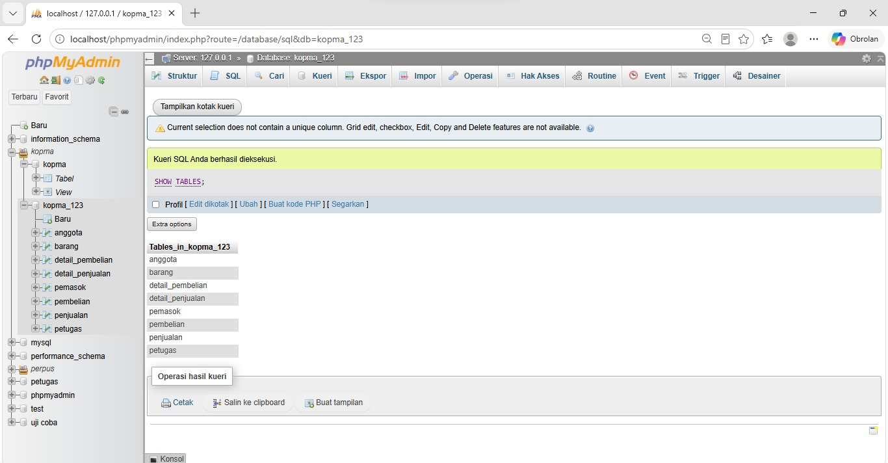

*Gambar 4. Delapan tabel Kopma pada `kopma_123`.*

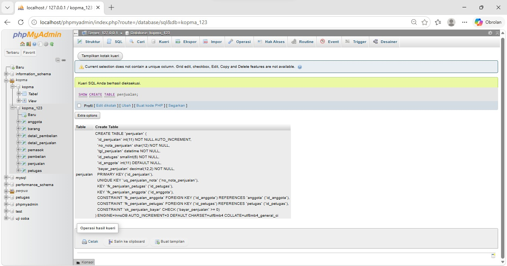

*Gambar 5. Struktur tabel `penjualan`: kunci primer, kunci unik, dua kunci tamu, dan CHECK.*

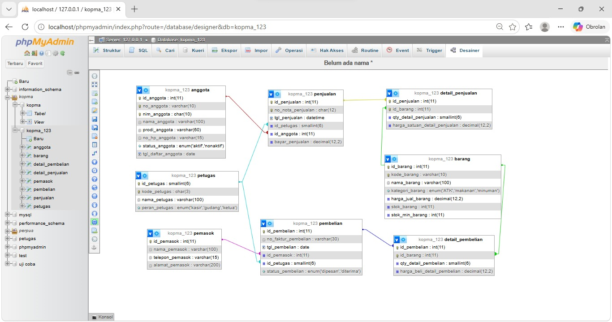

*Gambar 6. Tampilan Desainer phpMyAdmin untuk `kopma_123` (delapan tabel beserta relasinya).*

### 5.2 Proyek perpustakaan (`perpus_25430005`)

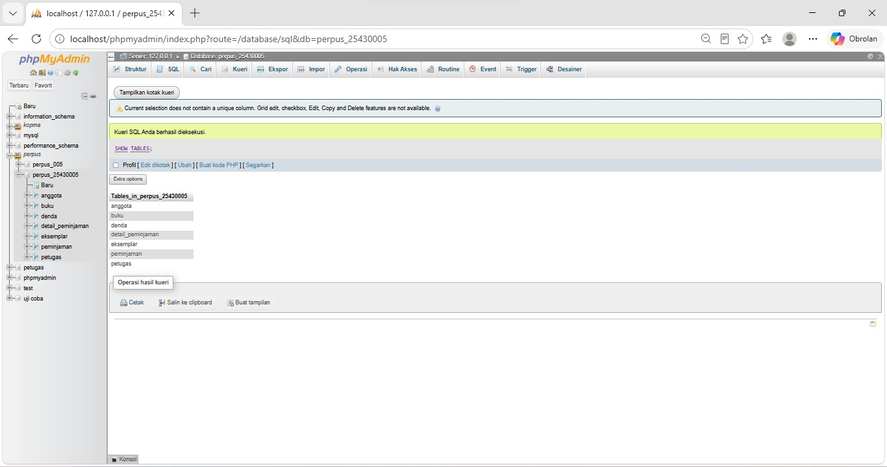

*Gambar 7. Tujuh tabel proyek pada `perpus_25430005`.*

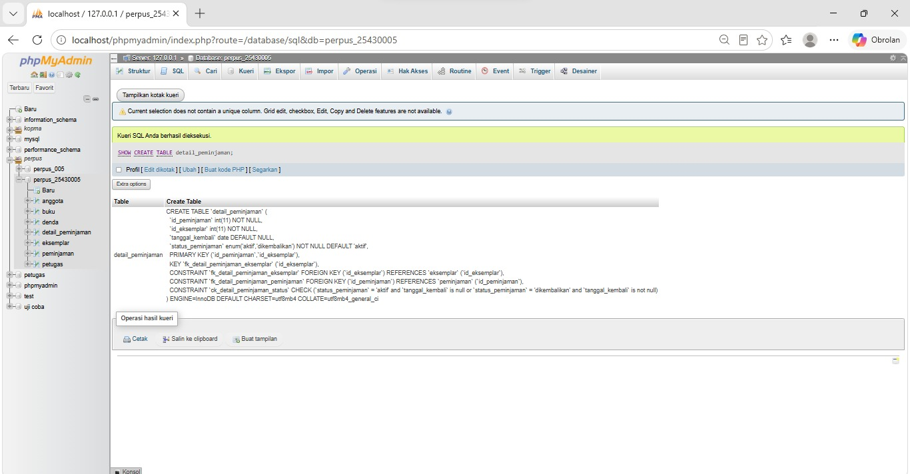

*Gambar 8. Struktur `detail_peminjaman`: kunci primer komposit, dua kunci tamu, dan `ck_detail_peminjaman_status`.*

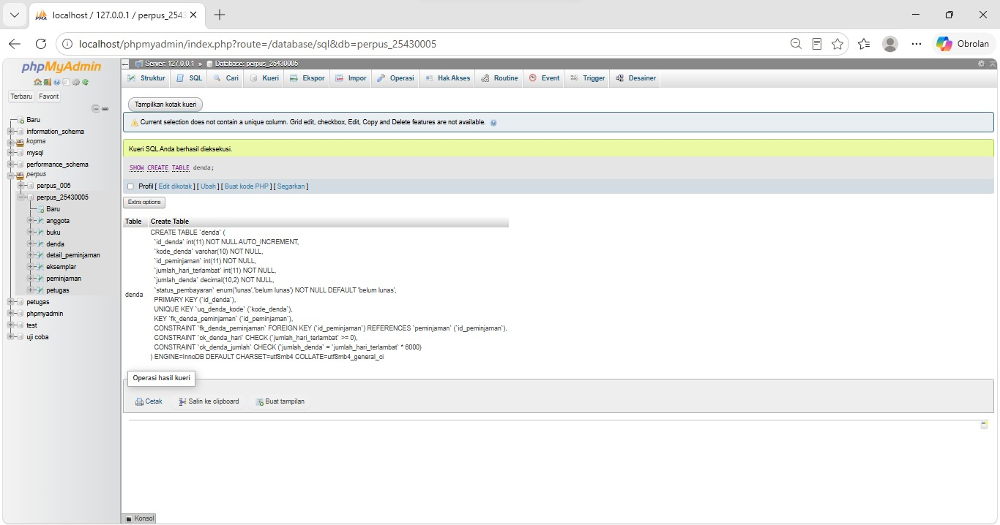

*Gambar 9. Struktur `denda`: `ck_denda_hari` dan `ck_denda_jumlah` (AB-07).*

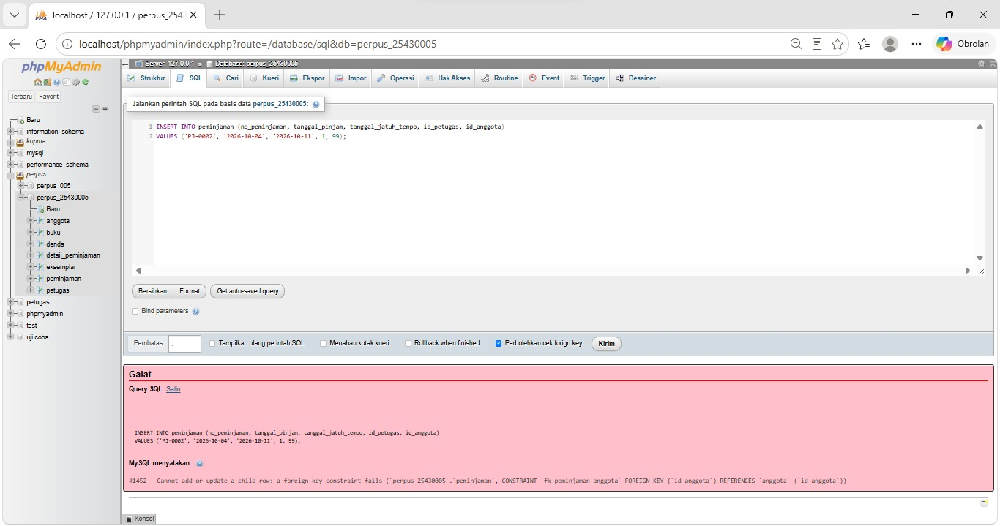

*Gambar 10. Galat 1452: peminjaman dengan anggota yang tidak ada ditolak.*

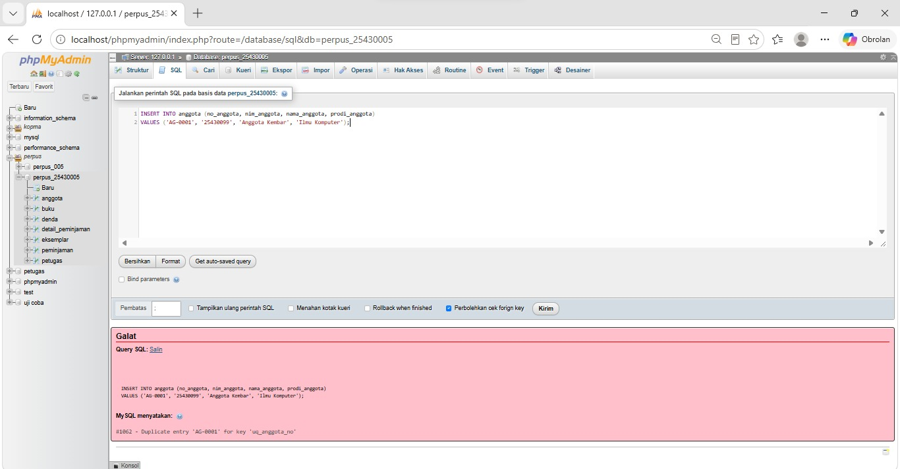

*Gambar 11. Galat 1062: nomor anggota kembar ditolak oleh `uq_anggota_no` (AB-01).*


*Gambar 12. Galat 4025: jatuh tempo sebelum tanggal pinjam ditolak oleh `ck_peminjaman_tempo`.*

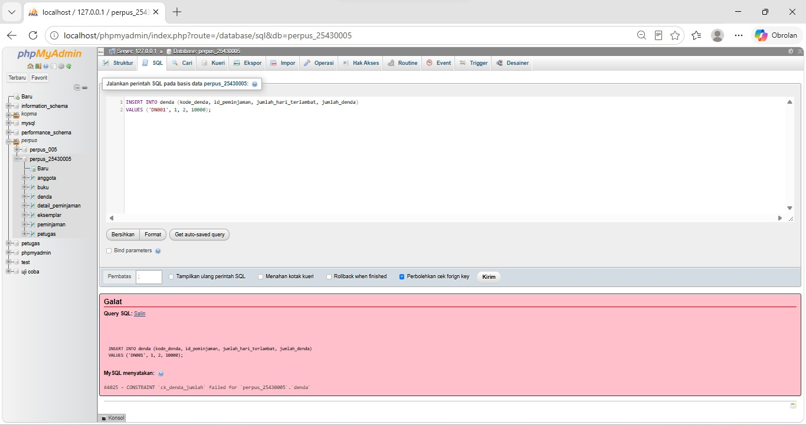

*Gambar 13. Galat 4025: denda yang tidak sama dengan hari terlambat dikali Rp6.000 ditolak oleh `ck_denda_jumlah` (AB-07).*

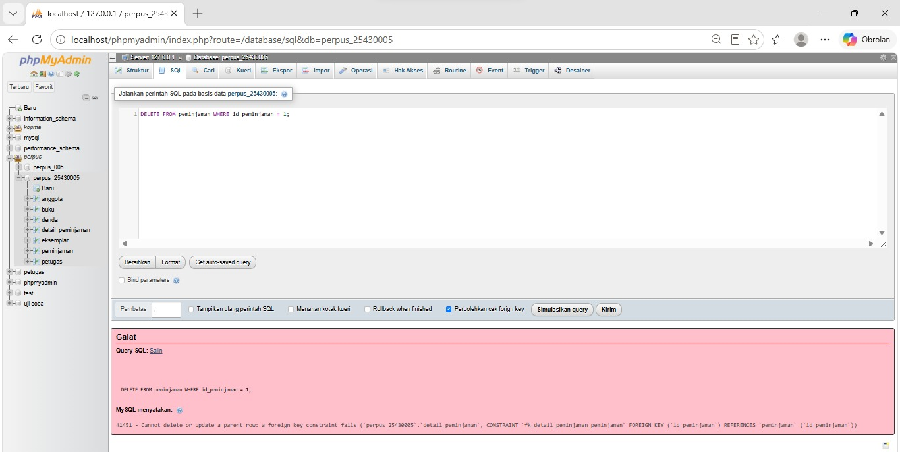

*Gambar 14. Galat 1451: peminjaman yang masih memiliki detail tidak dapat dihapus (NFR-01).*

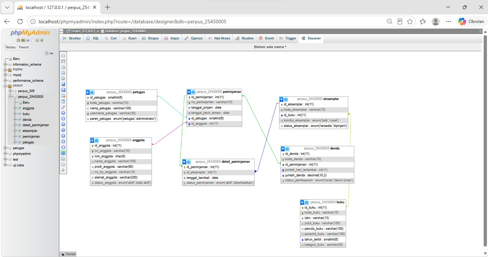

*Gambar 15. Tampilan Desainer phpMyAdmin untuk `perpus_25430005` (tujuh tabel beserta relasinya).*

### 5.3 ERD fisik proyek

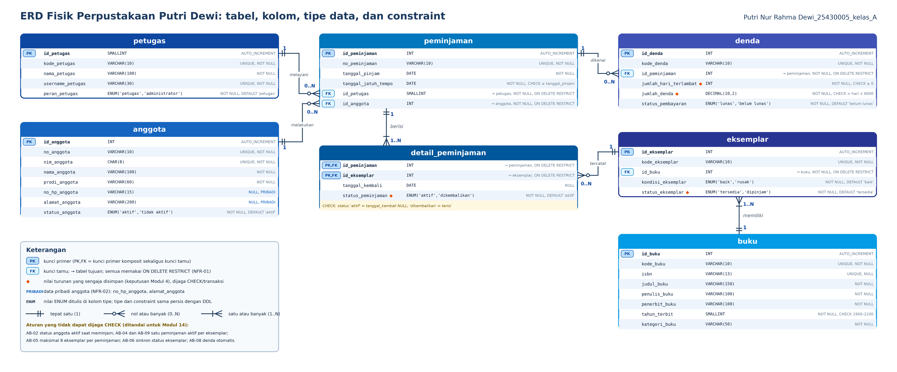

*Gambar 16. ERD fisik perpustakaan: tipe data, constraint, kunci tamu, dan nilai turunan yang disimpan.*

## 6. Analisis

### 6.1 Titik Analisis

**Titik Analisis 1.** `fk_detail_penjualan` memakai ON DELETE CASCADE karena baris detail tidak punya arti tanpa notanya. Jika nota dibatalkan, rinciannya sebaiknya ikut terhapus agar tidak ada detail yatim. `fk_detail_barang` tidak memakai CASCADE karena barang adalah data master yang dirujuk oleh banyak nota. Jika barang boleh dihapus beserta seluruh detailnya, baris penjualan lama ikut hilang sehingga laporan omzet dan barang terlaris menjadi salah. Karena itu penghapusan barang yang pernah terjual ditolak oleh server.

**Titik Analisis 2.** Galat 1452 melindungi aturan bahwa setiap nota wajib punya petugas yang dikenal (permintaan pengurus: tidak boleh ada nota tanpa kasir). Galat 4025 melindungi AB-03, yaitu stok tidak boleh negatif. Galat 1062 melindungi aturan keunikan kode, yaitu satu kode barang hanya untuk satu barang, sejenis dengan keunikan nomor nota (AB-01) dan keunikan nomor anggota atau NIM (AB-05). Aturan Kopma yang belum dapat dijaga constraint antara lain: diskon 5% hanya untuk anggota berstatus aktif (AB-02), karena menyangkut perhitungan dan status di tabel lain; harga di nota adalah harga saat transaksi (AB-04), karena constraint tidak dapat memaksa kasir menyalin harga; serta pemesanan ulang saat stok di bawah minimum (AB-06), karena itu tindakan otomatis, bukan validasi data.

**Titik Analisis 3.** `DROP TABLE IF EXISTS` harus dimulai dari `detail_pembelian` dan `detail_penjualan` karena tabel anak masih merujuk tabel induk lewat kunci tamu. Jika `petugas` dihapus lebih dulu, server menolak dengan ERROR 1451 (Cannot delete or update a parent row: a foreign key constraint fails). Urutan hapus harus kebalikan dari urutan buat: anak dulu, baru induk.

### 6.2 Latihan dan Modifikasi

Dua latihan berikut dikerjakan pada basis data `kopma_123`. Latihan 1 menambah constraint baru pada tabel `barang`, sedangkan Latihan 2 mengubah aksi ON DELETE pada kunci tamu `fk_penjualan_anggota`.

#### Latihan 1: Constraint `stok_min_barang` tidak boleh negatif

**Tujuan.** Kolom `stok_min_barang` menyimpan batas stok minimum yang memicu pemesanan ulang (AB-06). Nilai negatif tidak masuk akal, tetapi pada skrip awal kolom ini belum dijaga CHECK seperti `stok_barang` (AB-03). Constraint baru ditambahkan tanpa membuat ulang tabel.

**Langkah.**

1. Tambahkan constraint dengan `ALTER TABLE`:

```sql
ALTER TABLE barang
  ADD CONSTRAINT ck_barang_stok_min CHECK (stok_min_barang >= 0);
```

2. Periksa bahwa constraint sudah tercatat pada struktur tabel:

```sql
SHOW CREATE TABLE barang;
```

3. Buktikan constraint bekerja dengan satu perintah yang melanggar aturan:

```sql
UPDATE barang SET stok_min_barang = -5 WHERE id_barang = 1;
```

**Hasil.** Perintah `UPDATE` ditolak server dengan pesan:

```
#4025 - CONSTRAINT `ck_barang_stok_min` failed for `kopma_123`.`barang`
```

Nilai `stok_min_barang` pada barang 1 tetap seperti semula. Nama constraint pada pesan galat sama dengan yang ditulis pada `ALTER TABLE`, sehingga jelas bahwa penolakan berasal dari constraint baru, bukan dari constraint lain.


*Gambar 17. Latihan 1: nilai stok minimum negatif ditolak oleh `ck_barang_stok_min` (galat 4025).*

**Pembahasan.** Constraint CHECK menjaga aturan di tingkat server, sehingga nilai tidak masuk akal tertolak apa pun aplikasi atau pengguna yang mengirimkannya. Pada `ALTER TABLE ... ADD CONSTRAINT`, server juga memeriksa baris yang sudah ada. Constraint baru berhasil dibuat karena semua nilai `stok_min_barang` yang ada tidak negatif (bawaannya 5).

#### Latihan 2: `ON DELETE SET NULL` pada `fk_penjualan_anggota`

**Tujuan.** Pada skrip awal, `fk_penjualan_anggota` tidak memiliki aksi ON DELETE khusus, sehingga berlaku aksi bawaan RESTRICT: anggota yang sudah pernah tercatat di nota tidak dapat dihapus. Latihan ini mengubahnya agar anggota yang dihapus membuat `id_anggota` pada nota menjadi NULL, lalu menilai apakah perubahan itu sesuai AB-02 dan UU PDP.

**Langkah 1: siapkan data uji.** Satu anggota dan satu nota milik anggota itu:

```sql
INSERT INTO anggota (no_anggota, nim_anggota, nama_anggota, prodi_anggota, status_anggota, tgl_daftar_anggota)
VALUES ('A-0001', '2543000501', 'Anggota Uji', 'Ilmu Komputer', 'aktif', '2026-10-01');

INSERT INTO penjualan (no_nota_penjualan, tgl_penjualan, id_petugas, id_anggota, bayar_penjualan)
VALUES ('PJ-2610-0001', NOW(), 1,
        (SELECT id_anggota FROM anggota WHERE no_anggota = 'A-0001'), 10000);
```

**Langkah 2: perilaku sebelum diubah.** Hapus anggota yang sudah punya nota:

```sql
DELETE FROM anggota WHERE no_anggota = 'A-0001';
```

Perintah ditolak dengan galat 1451 (Cannot delete or update a parent row), karena aksi bawaan RESTRICT melindungi nota yang merujuk anggota itu.


*Gambar 18. Latihan 2: sebelum diubah, anggota yang punya nota tidak dapat dihapus (galat 1451).*

**Langkah 3: ubah aksi ON DELETE.** Kunci tamu dihapus lalu dibuat ulang dengan `ON DELETE SET NULL`:

```sql
ALTER TABLE penjualan DROP FOREIGN KEY fk_penjualan_anggota;

ALTER TABLE penjualan
  ADD CONSTRAINT fk_penjualan_anggota FOREIGN KEY (id_anggota)
  REFERENCES anggota (id_anggota) ON DELETE SET NULL;
```

Kolom `id_anggota` pada `penjualan` sudah berupa `NULL`, jadi aksi SET NULL dapat dijalankan.

**Langkah 4: uji setelah diubah.**

```sql
DELETE FROM anggota WHERE no_anggota = 'A-0001';

SELECT no_nota_penjualan, id_anggota FROM penjualan;
```

**Hasil.** Penghapusan anggota kini berhasil. Nota `PJ-2610-0001` tetap ada, tetapi `id_anggota` berubah menjadi NULL sehingga nota itu terbaca sebagai penjualan kepada pembeli umum.


*Gambar 19. Latihan 2: setelah diubah, anggota terhapus dan `id_anggota` pada nota menjadi NULL.*

**Pembahasan: kesesuaian dengan AB-02.** AB-02 menyatakan bahwa hanya anggota berstatus aktif yang memperoleh diskon 5%. Perubahan ini tidak sepenuhnya sesuai karena setelah anggota dihapus, nota yang pernah mendapat diskon tidak lagi dapat dikaitkan dengan anggota mana pun. Akibatnya, riwayat bahwa diskon diberikan secara sah kepada anggota aktif tidak dapat ditelusuri. Laporan belanja per anggota dan sepuluh anggota dengan belanja terbesar (KI-04) juga kehilangan data karena nota itu kini dianggap milik pembeli umum, sehingga angka omzet anggota menjadi lebih kecil dari yang sebenarnya.

**Pembahasan: kesesuaian dengan UU PDP.** Dari sisi pelindungan data pribadi, `SET NULL` menguntungkan karena data pribadi anggota seperti nama, NIM, dan nomor HP dapat dihapus tanpa ikut menghapus nota. Nota tetap tersimpan untuk kebutuhan pembukuan, sementara identitas pemiliknya tidak lagi melekat padanya. Cara ini mirip proses menganonimkan data.

**Kesimpulan latihan.** Aksi `ON DELETE SET NULL` cocok jika penghapusan anggota memang diizinkan dan Kopma lebih mengutamakan pelindungan data pribadi. Jika riwayat diskon dan laporan per anggota harus dijaga, pilihan yang lebih aman adalah tidak menghapus baris anggota, melainkan mengubah `status_anggota` menjadi `nonaktif` sehingga barisnya tetap ada sebagai jejak sejarah, seperti cara petugas diperlakukan. Karena itu aksi bawaan RESTRICT dipertahankan pada skrip akhir, dan perubahan pada Latihan 2 hanya dicoba untuk keperluan latihan.

### 6.3 Alasan Pemilihan Tipe Data Proyek

| Kolom | Tipe | Alasan |
|---|---|---|
| id_petugas | SMALLINT AUTO_INCREMENT | Jumlah petugas sedikit, SMALLINT cukup dan hemat ruang |
| id_anggota, id_buku, id_eksemplar, id_peminjaman, id_denda | INT AUTO_INCREMENT | Jumlah baris dapat bertambah banyak; kunci pengganti otomatis |
| no_anggota, no_peminjaman, kode_buku, kode_eksemplar, kode_denda, kode_petugas | VARCHAR(10) | Berupa kode berformat, bukan angka untuk dihitung |
| nim_anggota | CHAR(8) | Panjang selalu 8 dan berupa kode |
| nama, judul, penulis, penerbit | VARCHAR(100 / 150) | Panjang bervariasi |
| no_hp_anggota | VARCHAR(15) | Disimpan sebagai teks agar angka 0 di depan dan format nomor tidak hilang |
| isbn | VARCHAR(13) | Berupa kode (bukan untuk dihitung) dan boleh kosong |
| tahun_terbit | SMALLINT | Bilangan bulat kecil; dijaga CHECK 1900-2100 |
| tanggal_pinjam, tanggal_jatuh_tempo, tanggal_kembali | DATE | Hanya tanggal yang dibutuhkan, jam tidak |
| jumlah_hari_terlambat | INT | Bilangan bulat tidak negatif |
| jumlah_denda | DECIMAL(10,2) | Uang harus tepat; FLOAT menimbulkan galat pembulatan |
| status dan peran (anggota, eksemplar, peminjaman, denda, petugas) | ENUM(...) | Nilai terbatas dan sudah diketahui |

### 6.4 Kaitan Constraint dengan Aturan Bisnis

| Constraint | Aturan | Keterangan |
|---|---|---|
| uq_anggota_no | AB-01 | Nomor anggota unik |
| uq_anggota_nim, uq_buku_kode, uq_buku_isbn, uq_eksemplar_kode, uq_peminjaman_no, uq_denda_kode, uq_petugas_kode, uq_petugas_username | Kamus data P2 | Kode alami tetap unik walau kunci primer memakai id pengganti |
| fk_eksemplar_buku | AB-03 | Setiap eksemplar milik satu judul buku |
| ENUM status_eksemplar | AB-06 | Status hanya tersedia atau dipinjam |
| ENUM status_anggota | AB-02 | Dasar pemeriksaan anggota aktif |
| ENUM peran_petugas | AB-10, AB-11 | Dasar pembagian hak akses (Pertemuan 13) |
| fk_peminjaman_petugas, fk_peminjaman_anggota, fk_detail_*, fk_denda_peminjaman | NFR-01 | ON DELETE RESTRICT agar riwayat transaksi tidak hilang |
| ck_peminjaman_tempo | Kamus data | Jatuh tempo tidak boleh sebelum tanggal pinjam |
| ck_detail_peminjaman_status | Keputusan Modul 4 | Status dikembalikan jika dan hanya jika tanggal_kembali terisi |
| ck_denda_hari | AB-08 | Hari terlambat tidak negatif |
| ck_denda_jumlah | AB-07 | Denda = hari terlambat x Rp6.000 |
| ck_buku_tahun | Kamus data | Tahun terbit harus valid |

Aturan yang tidak dapat dijaga CHECK karena melibatkan banyak baris atau tabel lain, sehingga ditandai untuk Modul 14: AB-02 (hanya anggota aktif boleh meminjam), AB-04 dan AB-09 (satu eksemplar hanya satu peminjaman aktif), AB-05 (maksimal 8 eksemplar per peminjaman), sinkronisasi `status_eksemplar` dengan `detail_peminjaman` (AB-06, NFR-04), dan AB-08 (denda dibuat otomatis saat pengembalian terlambat). Karena tarif Rp6.000 tertanam di `ck_denda_jumlah`, jika tarif berubah constraint itu diperbarui lewat ALTER.

### 6.5 Perbandingan Desainer dengan ERD

- Desainer menampilkan tabel, tipe data, kunci primer, dan garis relasi, tetapi tidak menampilkan UNIQUE, CHECK, DEFAULT, AUTO_INCREMENT, dan aksi ON DELETE. Hal-hal itu hanya terlihat lewat `SHOW CREATE TABLE`, sedangkan ERD fisik memuat semuanya.
- Garis relasi di Desainer tidak berlabel kardinalitas (1 atau 0..N) dan nama relasi, sedangkan ERD menuliskannya.
- Letak tabel di Desainer diatur manual sehingga dapat berbeda dari ERD.
- Pada Kopma, ERD Pertemuan 3 memuat 9 tabel (termasuk `transaksi_poin`) dengan beberapa tipe data berbeda (`no_anggota` CHAR(6), `no_faktur_pembelian` VARCHAR(20), `qty_detail_pembelian` INT), sedangkan DDL Pertemuan 5 mengikuti skema kanonik Modul 5 dengan 8 tabel serta `no_anggota` VARCHAR(10), `no_faktur_pembelian` VARCHAR(30), dan `qty_detail_pembelian` SMALLINT. Tabel `transaksi_poin` belum dibuat karena tidak termasuk delapan tabel kanonik Modul 5.
- Dibandingkan ERD Pertemuan 3 untuk proyek, ERD fisik Pertemuan 5 menambahkan `isbn` sebagai UNIQUE, aksi `ON DELETE RESTRICT` pada semua kunci tamu, CHECK untuk tahun terbit, status detail, dan jumlah denda, serta penanda untuk data pribadi dan nilai turunan.

## 7. Masalah yang Dihadapi dan Solusinya

1. **Skrip dijalankan di database yang salah.** Pada percobaan pertama, galat 1452 muncul di database `kopma`, bukan `kopma_123`. Solusinya, saya memilih `kopma_123` di panel kiri sebelum menjalankan skrip, lalu mengulang pembuktian.
2. **Hasil tempel dari PDF salah.** Kode yang disalin dari PDF menimbulkan galat. Solusinya, skrip ditulis dalam berkas `.sql` dan dimuat lewat tab Impor phpMyAdmin.
3. **Galat lama masih tampil.** Perintah sebelumnya masih ada di kotak SQL sehingga tampak seolah skrip gagal. Solusinya, kotak SQL dibersihkan sebelum menempel dan memastikan tombol Kirim sudah diklik.
4. **Hasil SHOW CREATE TABLE terpotong.** Solusinya memakai opsi tampil teks lengkap sampai semua constraint terlihat.
5. **Nama halaman Desainer tidak dapat disimpan.** Tulisan "Belum ada nama" tetap muncul karena fitur penyimpanan konfigurasi phpMyAdmin tidak aktif. Ini tidak memengaruhi isi Desainer, sehingga dibiarkan.
6. **Tabel sisa dan collation.** Tabel `produk` sisa latihan sebelumnya ada di `kopma_123` dan dihapus agar hanya delapan tabel Kopma yang tampil. Collation basis data bawaan adalah `utf8mb4_general_ci`, bukan `utf8mb4_unicode_ci`; constraint tetap bekerja sehingga dibiarkan.

## 8. Kesimpulan

Skema 3NF dari Pertemuan 4 berhasil diwujudkan menjadi delapan tabel Kopma dan tujuh tabel perpustakaan di MariaDB. Constraint PRIMARY KEY, FOREIGN KEY, UNIQUE, NOT NULL, DEFAULT, dan CHECK terbukti menolak data yang melanggar aturan: galat 1452, 1062, 4025, dan 1451 muncul sesuai harapan. Pemilihan tipe data dan aksi ON DELETE ditentukan oleh sifat data dan aturan bisnis, misalnya DECIMAL untuk uang dan RESTRICT untuk menjaga riwayat transaksi.

Tidak semua aturan bisnis dapat dijaga struktur. Aturan yang melibatkan banyak baris atau tabel lain, seperti batas delapan eksemplar per peminjaman, perlu diselesaikan dengan transaksi dan trigger pada Modul 14.

## 9. Kaitan dengan Pertemuan 6

Pertemuan 6 akan mengisi tabel-tabel ini dengan data sampel dan skenario uji. Constraint yang belum diuji belum dianggap bekerja, sehingga skenario uji nanti perlu menyentuh setiap constraint di dokumen ini.

---

## 10. Bukti Git

- **Repositori:** https://github.com/putriid990-ai/basisdata-25430005

Riwayat commit yang digunakan sebagai bukti pengerjaan Milestone Proyek 5 adalah sebagai berikut.

| Hash commit | Pesan commit |
|---|---|
| 12a9a01 | `p05: ddl kopma` |
| 48f3018 | `p05: ddl proyek perpustakaan` |
| 04b4d8c | `p05: tambah ERD fisik, bukti, dan laporan` |

## Checklist

| Status | Jenis | Yang harus ada |
|---|---|---|
| [√] | Berkas wajib | `p05_ddl_25430005.sql` (dapat dijalankan ulang dari basis data kosong) dan ERD fisik `p05_erd_fisik_25430005` |
| [√] | Bukti tangkapan layar | `SHOW CREATE TABLE` tabel utama; galat saat constraint dilanggar (FK, UNIQUE, CHECK) |
| [√] | Analisis wajib | Alasan pemilihan tipe data dan constraint; kaitan constraint dengan AB-xx |
