# Laporan Praktikum Basis Data - Pertemuan 6: Mengisi, Mengubah, dan Menguji Data dengan DML

- Nama: Putri Nur Rahma Dewi
- NIM: 25430005
- Kelas: A
- Mata Kuliah: Basis Data (Semester 3)

---

## 1. Tujuan

1. Menambah data dengan INSERT satu baris, banyak baris, dan INSERT ... SELECT.
2. Mengubah dan menghapus data dengan UPDATE dan DELETE secara aman memakai mode `sql_safe_updates`.
3. Menyusun skenario uji positif dan negatif serta mencatat hasilnya.
4. Menyiapkan data sampel proyek yang dapat dibangun ulang dari skrip.

## 2. Alat dan Bahan

- XAMPP 8.2.12 (MariaDB 10.4.32) dan phpMyAdmin.
- Basis data `kopma_123` (latihan Kopma) dan `perpus_25430005` (proyek perpustakaan) hasil Modul 5.
- Parameter P = 6, dari perhitungan P = (05 mod 9) + 1 pada Modul 2.
- Editor teks dan repositori `basisdata-25430005`.

## 3. Ringkasan Langkah Percobaan Kopma

Pada latihan Kopma, saya menulis `p06_data_kopma_25430005.sql` yang diisi dengan urutan induk dahulu, anak kemudian, mengikuti urutan pembuatan tabel pada Modul 5. Data induk terdiri dari 5 petugas, 8 barang, 6 anggota (dua di antaranya nonaktif), dan 3 pemasok, diisi dengan INSERT banyak baris.

Nota contoh `PJ-2609-0142` dicatat dengan `INSERT ... SELECT` yang mengambil harga dari tabel barang, sehingga harga satuan di detail nota sama dengan harga jual saat transaksi (AB-04). Setiap nota diikuti `UPDATE` yang mengurangi stok barang sesuai jumlah yang terjual. Selain itu dicatat tiga nota lain dan dua faktur pembelian (satu diterima, satu dipesan).

Setelah data terisi, saya menjalankan sebelas skenario uji (UJ-01 sampai UJ-11). Sebagian membuktikan data yang benar diterima, sebagian membuktikan data yang salah ditolak oleh constraint, dan satu (UJ-09) membuktikan aturan yang belum dapat dijaga server. Mode `sql_safe_updates` diuji pada UJ-08. Skrip dan skenario lengkap ada di `p06_data_kopma_25430005.sql` dan `p06_uji_kopma_25430005.md`.

## 4. Milestone Proyek 6: Data Perpustakaan

Pada proyek perpustakaan, saya menulis `p06_data_25430005.sql` yang dapat dijalankan setelah `p05_ddl_25430005.sql` dari basis data kosong. Setiap tabel induk memiliki minimal 5 baris: 5 petugas, 12 anggota (dua tidak aktif), 10 buku, dan 25 eksemplar (dua berkondisi rusak).

Berdasarkan P = 6, tabel transaksi utama berisi **60 peminjaman** (10 × P) yang tersebar pada 30 tanggal berbeda, mulai 7 September sampai 16 Oktober 2026, dengan 92 detail peminjaman dan 8 denda. Kunci tamu diisi dengan subkueri memakai kode alami (misalnya `no_anggota` dan `kode_eksemplar`), bukan dengan menebak nilai id. Data dibuat konsisten dengan aturan bisnis: peminjam selalu anggota aktif (AB-02), maksimal 3 eksemplar per peminjaman (batasnya 8, AB-05), tidak ada eksemplar yang dipinjam dua kali sekaligus (AB-09), status eksemplar sesuai peminjaman aktif (AB-06), dan denda sama dengan hari terlambat dikali Rp6.000 (AB-07).

Skenario uji proyek ada di `p06_uji_25430005.md` dan berjumlah 14: 3 uji positif, 8 uji negatif, dan 3 uji aturan yang belum dapat dijaga server.

## 5. Bukti Tangkapan Layar

### 5.1 Kopma (`kopma_123`)

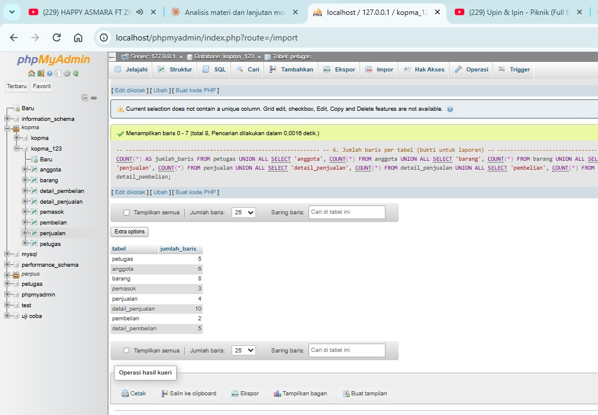

*Gambar 1. Jumlah baris per tabel Kopma setelah data diisi: petugas 5, anggota 6, barang 8, pemasok 3, penjualan 4, detail_penjualan 10, pembelian 2, detail_pembelian 5.*

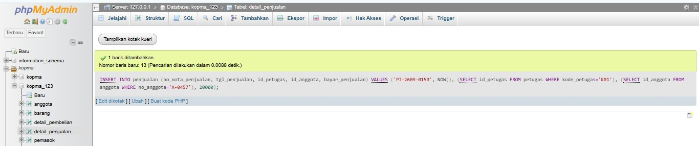

*Gambar 2. UJ-01 (uji positif): nota baru dengan anggota aktif diterima.*

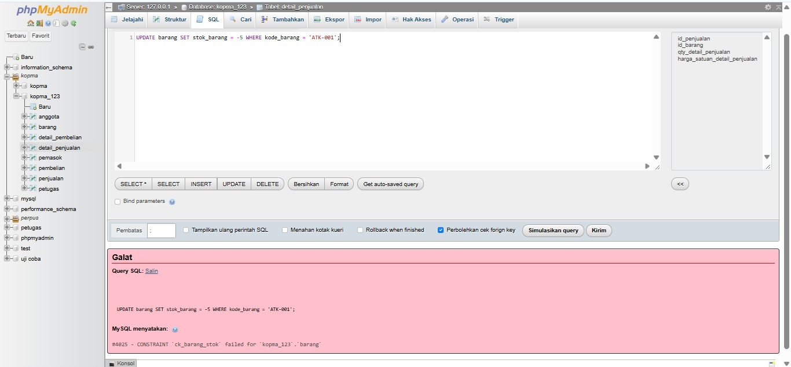

*Gambar 3. UJ-03 (uji negatif): stok -5 ditolak oleh `ck_barang_stok` (galat 4025, AB-03).*

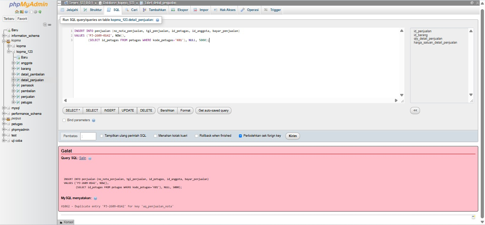

*Gambar 4. UJ-04 (uji negatif): nomor nota yang sudah ada ditolak oleh `uq_penjualan_nota` (galat 1062, AB-01).*

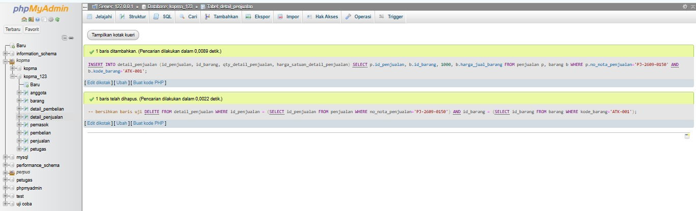

*Gambar 5. UJ-09 (uji gagal): qty 1000 melebihi stok 114 tetap diterima karena aturannya belum dijaga server.*

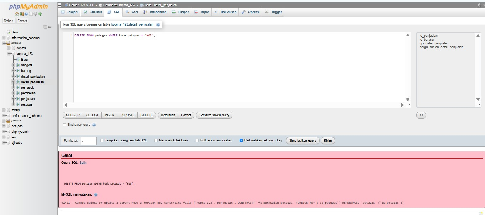

*Gambar 6. UJ-11 (uji negatif): petugas yang pernah melayani penjualan tidak dapat dihapus (galat 1451).*

### 5.2 Proyek perpustakaan (`perpus_25430005`)

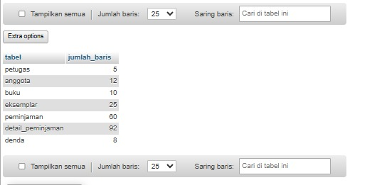

*Gambar 7. Jumlah baris per tabel proyek: petugas 5, anggota 12, buku 10, eksemplar 25, peminjaman 60, detail_peminjaman 92, denda 8.*

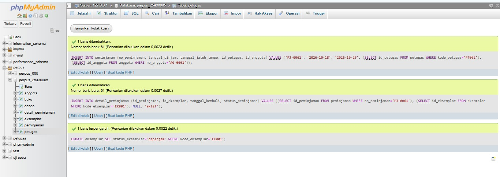

*Gambar 8. UP-01 (uji positif): peminjaman oleh anggota aktif untuk eksemplar tersedia diterima.*

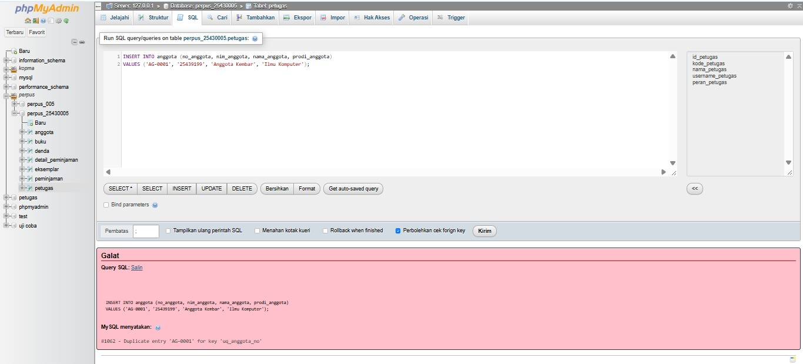

*Gambar 9. UN-05 (uji negatif): nomor anggota kembar ditolak oleh `uq_anggota_no` (galat 1062, AB-01).*

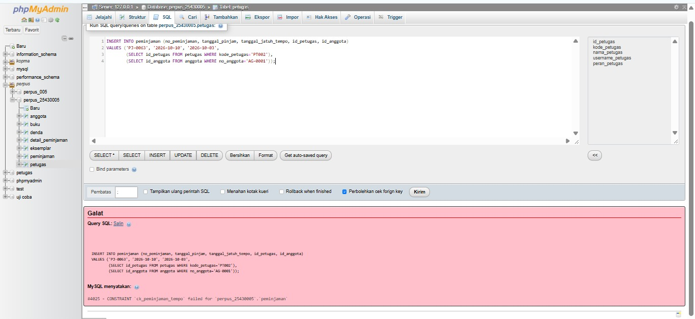

*Gambar 10. UN-06 (uji negatif): jatuh tempo sebelum tanggal pinjam ditolak oleh `ck_peminjaman_tempo` (galat 4025).*

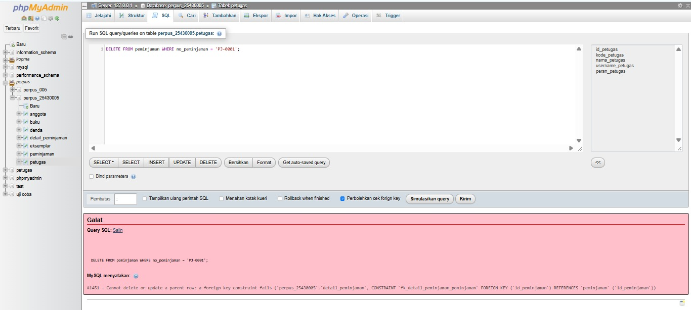

*Gambar 11. UN-09 (uji negatif): peminjaman yang masih punya detail tidak dapat dihapus (galat 1451, NFR-01).*

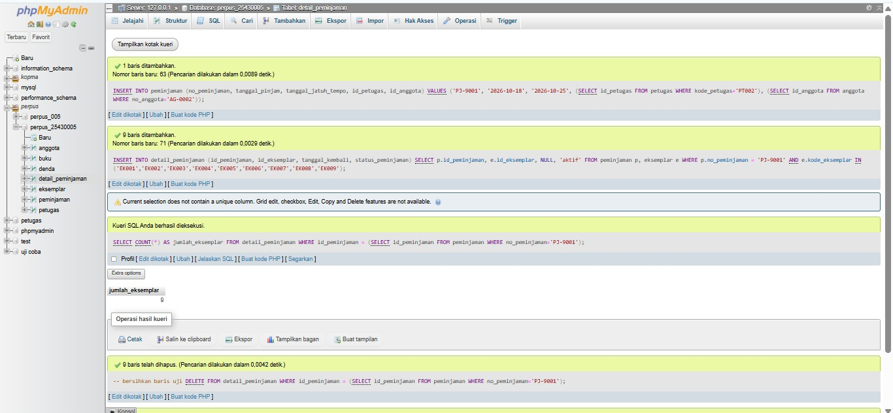

*Gambar 12. UG-12 (uji gagal): satu peminjaman memuat 9 eksemplar tetap diterima padahal batasnya 8 (AB-05).*

## 6. Analisis

### 6.1 Titik Analisis

**Titik Analisis 1.** `INSERT ... SELECT` mengambil harga langsung dari tabel `barang`, sehingga tidak ada risiko salah ketik dan harga yang tercatat pasti harga yang berlaku saat transaksi. Jika harga pulpen naik menjadi Rp4.500 minggu depan, nota `PJ-2609-0142` tidak ikut berubah, karena harga sudah tersalin ke `harga_satuan_detail_penjualan` pada saat nota dicatat (AB-04). Harga di tabel `barang` hanya memengaruhi nota yang dibuat sesudahnya.

**Titik Analisis 2.** Menghapus nota ikut menghapus detailnya karena `fk_detail_penjualan_penjualan` didefinisikan dengan `ON DELETE CASCADE`: baris detail tidak punya arti tanpa notanya. Menghapus petugas ditolak karena `fk_penjualan_petugas` memakai aksi bawaan RESTRICT, sehingga petugas yang pernah melayani penjualan tidak dapat dihapus (galat 1451). Jika seorang kasir berhenti bekerja, barisnya tidak dihapus. Akunnya dikunci dan perannya dicabut, sedangkan barisnya tetap ada sebagai jejak sejarah transaksi.

**Titik Analisis 3.** Uji yang diperkirakan gagal adalah UJ-09, yaitu detail penjualan dengan qty melebihi stok. Constraint `CHECK (stok_barang >= 0)` hanya memeriksa nilai pada baris `barang` yang sedang disisipkan atau diubah. Kuantitas yang dijual berada di tabel lain (`detail_penjualan`), sedangkan CHECK tidak dapat melihat tabel lain. Karena itu `INSERT` detail dengan qty 1000 diterima, dan stok baru ditolak jika `UPDATE`-nya dijalankan sampai bernilai negatif. Aturan ini harus dijaga dengan transaksi dan trigger pada Modul 14.

### 6.2 Latihan dan Modifikasi

**Latihan 1: pengarsipan anggota nonaktif sebelum 2025.** Anggota nonaktif yang mendaftar sebelum 2025 dipindahkan ke tabel `anggota_arsip` dengan `CREATE TABLE ... LIKE` dan `INSERT ... SELECT`, lalu dihapus dari tabel asal. Syarat `id_anggota NOT IN (SELECT id_anggota FROM penjualan WHERE id_anggota IS NOT NULL)` memastikan anggota yang masih punya penjualan tidak ikut terhapus.

```sql
CREATE TABLE anggota_arsip LIKE anggota;

INSERT INTO anggota_arsip
SELECT * FROM anggota
WHERE status_anggota = 'nonaktif' AND tgl_daftar_anggota < '2025-01-01'
  AND id_anggota NOT IN (SELECT id_anggota FROM penjualan WHERE id_anggota IS NOT NULL);

DELETE FROM anggota WHERE id_anggota IN (SELECT id_anggota FROM anggota_arsip);
```

Hasilnya, anggota A-0301 (nonaktif, tanpa nota) berpindah ke `anggota_arsip`, sedangkan A-0302 (nonaktif tetapi memiliki nota PJ-2609-0131) tetap berada di tabel `anggota`.

**Latihan 2: kenaikan harga makanan 5%.** Satu `UPDATE` menaikkan harga semua barang kategori makanan sebesar 5% dan membulatkannya ke ratusan terdekat. Syarat `id_barang > 0` memenuhi mode aman karena memakai kolom kunci.

```sql
UPDATE barang
SET harga_jual_barang = ROUND(harga_jual_barang * 1.05, -2)
WHERE kategori_barang = 'makanan' AND id_barang > 0;
```

Hasilnya, Roti Cokelat naik dari 5.000 menjadi 5.300, Biskuit Gandum dari 7.500 menjadi 7.900, dan Wafer Cokelat dari 3.000 menjadi 3.200.

### 6.3 Skenario Uji Kopma

| Kode | Masukan | Hasil yang diharapkan | Hasil nyata | Status |
|---|---|---|---|---|
| UJ-01 | Nota baru dengan anggota aktif (AB-02) | Diterima | Diterima, 1 baris ditambahkan | LULUS |
| UJ-02 | Nota tanpa anggota (pembeli umum) | Diterima, `id_anggota` NULL | Diterima, `id_anggota` berisi NULL | LULUS |
| UJ-03 | Stok diubah menjadi -5 (AB-03) | Ditolak, ERROR 4025 | Ditolak: #4025 `ck_barang_stok` failed | LULUS |
| UJ-04 | Nota dengan nomor yang sudah ada (AB-01) | Ditolak, ERROR 1062 | Ditolak: #1062 Duplicate entry 'PJ-2609-0142' | LULUS |
| UJ-05 | Detail dengan qty 0 | Ditolak, ERROR 4025 | Ditolak: #4025 `ck_detail_penjualan_qty` failed | LULUS |
| UJ-06 | Anggota dengan NIM kembar (AB-05) | Ditolak, ERROR 1062 | Ditolak: #1062 Duplicate entry '2543010101' | LULUS |
| UJ-07 | Penjualan oleh petugas tidak dikenal | Ditolak, ERROR 1452 | Ditolak: #1452 `fk_penjualan_petugas` | LULUS |
| UJ-08 | UPDATE tanpa WHERE di mode aman | Ditolak, ERROR 1175 | Ditolak: #1175 safe update mode | LULUS |
| UJ-09 | Detail dengan qty 1000 melebihi stok 114 (AB-03) | Seharusnya ditolak | Diterima | **GAGAL** |
| UJ-10 | Hapus nota, detailnya ikut terhapus (CASCADE) | Diterima, detail kembali 10 | Detail 10, 11, lalu kembali 10 | LULUS |
| UJ-11 | Hapus petugas yang pernah melayani penjualan | Ditolak, ERROR 1451 | Ditolak: #1451 `fk_penjualan_petugas` | LULUS |

Sepuluh uji berstatus LULUS dan satu uji (UJ-09) berstatus GAGAL, sesuai perkiraan pada Titik Analisis 3.

### 6.4 Skenario Uji Proyek Perpustakaan

| Kode | Masukan | Hasil yang diharapkan | Hasil nyata | Status |
|---|---|---|---|---|
| UP-01 | Peminjaman baru oleh anggota aktif untuk eksemplar tersedia (AB-02, AB-06) | Diterima | Diterima, peminjaman, detail, dan status eksemplar masuk | LULUS |
| UP-02 | Pengembalian: tanggal kembali dan status diisi bersama | Diterima, 1 baris diubah | Diterima, 1 baris diubah | LULUS |
| UP-03 | Denda 2 hari = Rp12.000 (AB-07) | Diterima | Diterima, 1 baris ditambahkan | LULUS |
| UN-04 | Peminjaman dengan anggota yang tidak ada | Ditolak, ERROR 1452 | Ditolak: #1452 `fk_peminjaman_anggota` | LULUS |
| UN-05 | Nomor anggota kembar (AB-01) | Ditolak, ERROR 1062 | Ditolak: #1062 `uq_anggota_no` | LULUS |
| UN-06 | Jatuh tempo sebelum tanggal pinjam | Ditolak, ERROR 4025 | Ditolak: #4025 `ck_peminjaman_tempo` failed | LULUS |
| UN-07 | Status dikembalikan tanpa tanggal kembali | Ditolak, ERROR 4025 | Ditolak: #4025 `ck_detail_peminjaman_status` failed | LULUS |
| UN-08 | Denda 2 hari tetapi Rp10.000 (AB-07) | Ditolak, ERROR 4025 | Ditolak: #4025 `ck_denda_jumlah` failed | LULUS |
| UN-09 | Hapus peminjaman yang masih punya detail (NFR-01) | Ditolak, ERROR 1451 | Ditolak: #1451 `fk_detail_peminjaman_peminjaman` | LULUS |
| UN-10 | UPDATE tanpa WHERE di mode aman | Ditolak, ERROR 1175 | Ditolak: #1175 safe update mode | LULUS |
| UN-11 | Kode eksemplar kembar | Ditolak, ERROR 1062 | Ditolak: #1062 `uq_eksemplar_kode` | LULUS |
| UG-12 | Satu peminjaman memuat 9 eksemplar (AB-05, maksimal 8) | Seharusnya ditolak | Diterima, 9 eksemplar tersimpan | **GAGAL** |
| UG-13 | Eksemplar yang sedang dipinjam dipinjam lagi (AB-04, AB-09) | Seharusnya ditolak | Diterima | **GAGAL** |
| UG-14 | Peminjaman oleh anggota tidak aktif (AB-02) | Seharusnya ditolak | Diterima | **GAGAL** |

Sebelas uji berstatus LULUS (3 positif dan 8 negatif), dan tiga uji berstatus GAGAL karena aturan bisnisnya belum dapat dijaga server.

### 6.5 Utang Desain untuk Modul 14

| Uji | Aturan | Mengapa belum dapat dijaga | Rencana penyelesaian |
|---|---|---|---|
| UG-12 | AB-05: maksimal 8 eksemplar per peminjaman | CHECK hanya melihat satu baris, sedangkan jumlah eksemplar adalah hitungan banyak baris di `detail_peminjaman` | Trigger atau prosedur peminjaman |
| UG-13 | AB-04 dan AB-09: satu eksemplar hanya satu peminjaman aktif | Kunci primer detail hanya mencegah eksemplar ganda dalam satu peminjaman, bukan antarpeminjaman | Trigger atau transaksi yang memeriksa dan mengubah status eksemplar |
| UG-14 | AB-02: hanya anggota aktif boleh meminjam | Status berada di tabel `anggota`, sedangkan kunci tamu hanya memeriksa keberadaan id | Pemeriksaan di dalam prosedur peminjaman |
| UJ-09 (Kopma) | AB-03: qty tidak boleh melebihi stok | CHECK pada `barang` tidak melihat qty di `detail_penjualan` | Transaksi yang mengurangi stok dan mencatat nota sekaligus |

## 7. Masalah yang Dihadapi dan Solusinya

1. **Hasil uji awal tidak sesuai harapan.** Pada percobaan pertama, UJ-04, UJ-06, UJ-10, dan UJ-11 berhasil diterima atau menghasilkan hasil yang berbeda dari yang diharapkan. Penyebabnya, data Modul 6 belum terisi dengan benar karena diimpor tanpa menjalankan DDL lebih dulu, sehingga tabel masih berisi sisa data uji Modul 5. Solusinya, saya mengimpor ulang `p05_ddl_kopma_25430005.sql`, lalu `p06_data_kopma_25430005.sql`, memeriksa jumlah baris per tabel, dan mengulang uji dari UJ-01.
2. **UJ-01 gagal ketika diulang.** Pada pengulangan untuk keperluan screenshot, UJ-01 menghasilkan galat 1062 karena nota `PJ-2609-0150` sudah dibuat pada percobaan pertama. Solusinya, nota uji dihapus (`DELETE FROM penjualan WHERE no_nota_penjualan IN (...)`) sebelum UJ-01 diulang, atau database direset dari skrip.
3. **Uji mengubah data.** Beberapa skenario (misalnya UP-01 dan UP-03) menambah data baru sehingga kondisi database berbeda dari keadaan awal, dan nomor yang sama tidak dapat dipakai dua kali. Solusinya, setiap pengulangan uji dimulai dari reset: DDL dijalankan lebih dulu, lalu data. Skrip dapat diulang karena diawali `DROP TABLE IF EXISTS`.

## 8. Kesimpulan

Data sampel Kopma dan proyek perpustakaan berhasil diisi dari skrip yang dapat dijalankan ulang dari basis data kosong. Data proyek berbasis parameter P = 6, yaitu 60 peminjaman pada 30 tanggal berbeda, dan setiap tabel induk memiliki minimal 5 baris.

Skenario uji membuktikan bahwa constraint menolak data yang salah (galat 1062, 1452, 4025, dan 1451), dan mode `sql_safe_updates` menolak UPDATE tanpa kunci (galat 1175). Uji positif membuktikan bahwa data yang benar diterima. Empat uji yang gagal (UJ-09, UG-12, UG-13, dan UG-14) menunjukkan aturan bisnis yang melibatkan banyak baris atau tabel lain belum dapat dijaga PRIMARY KEY, UNIQUE, FOREIGN KEY, maupun CHECK. Aturan itu dicatat sebagai utang desain untuk diselesaikan dengan transaksi dan trigger pada Modul 14.

## 9. Kaitan dengan Pertemuan 7

Data sampel ini menjadi bahan seluruh kueri Pertemuan 7 sampai 15. Karena itu data dibuat realistis, dengan nama, judul, dan tanggal yang masuk akal, bukan "abc" atau "test1", dan keduanya dapat dibangun ulang dari skrip kapan saja.

---

## 10. Bukti Git

- **Repositori:** https://github.com/putriid990-ai/basisdata-25430005

Riwayat commit yang digunakan sebagai bukti pengerjaan Milestone Proyek 6 adalah sebagai berikut.

| Hash commit | Pesan commit |
|---|---|
| `12ac23a` | `Menambahkan tugas Praktikum 06` |
| `9a2797c` | `p06: perbaiki laporan dan bukti` |
| `54e1081` | `p06: perbaiki gambar dan laporan` |

## Checklist

| Status | Jenis | Yang harus ada |
|---|---|---|
| [√] | Berkas wajib | `p06_data_25430005.sql` (data sampel berbasis parameter P) dan `p06_uji_25430005.md` (skenario uji) |
| [√] | Bukti tangkapan layar | Hasil skenario uji positif dan negatif; jumlah baris per tabel |
| [√] | Analisis wajib | Tabel skenario uji: masukan, hasil yang diharapkan, hasil nyata, status |
