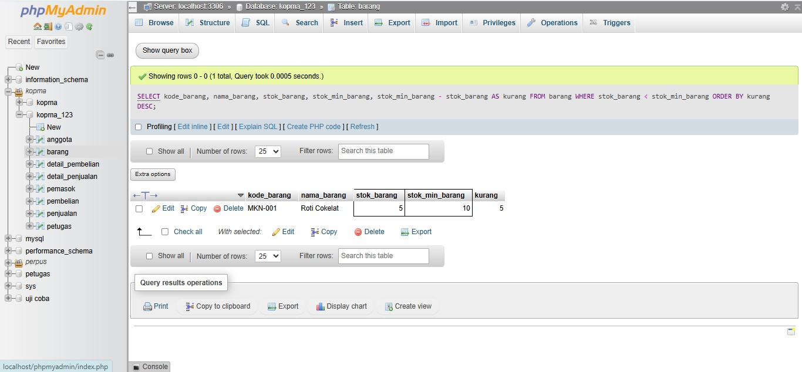
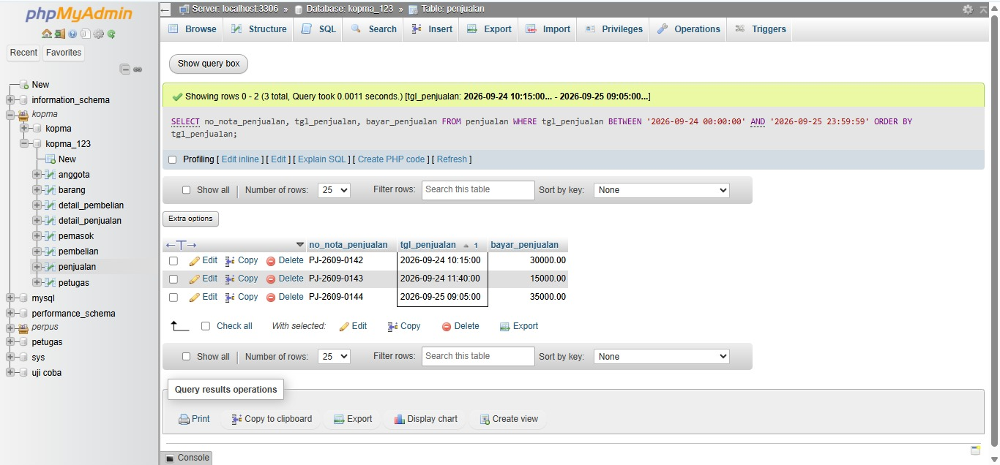
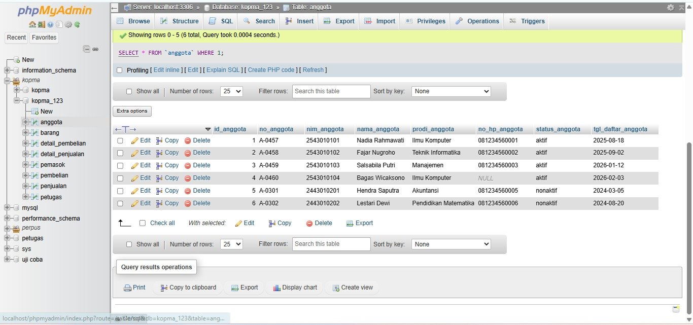
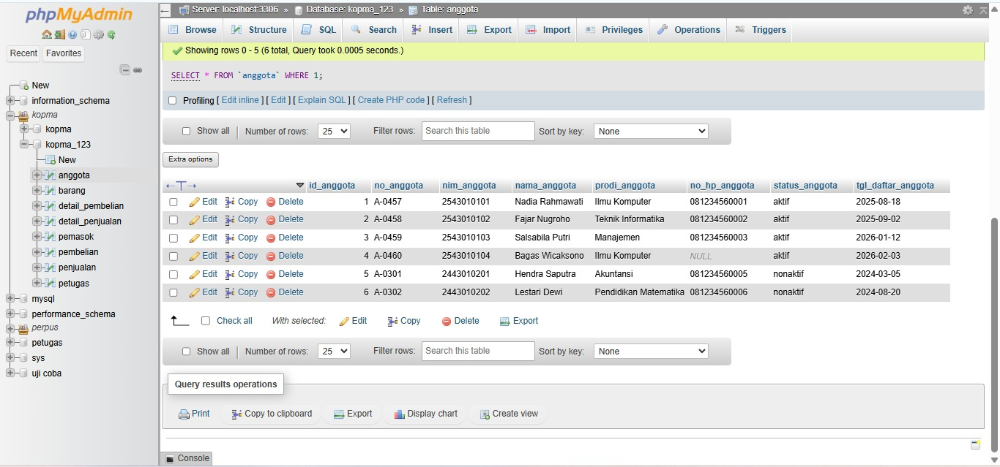
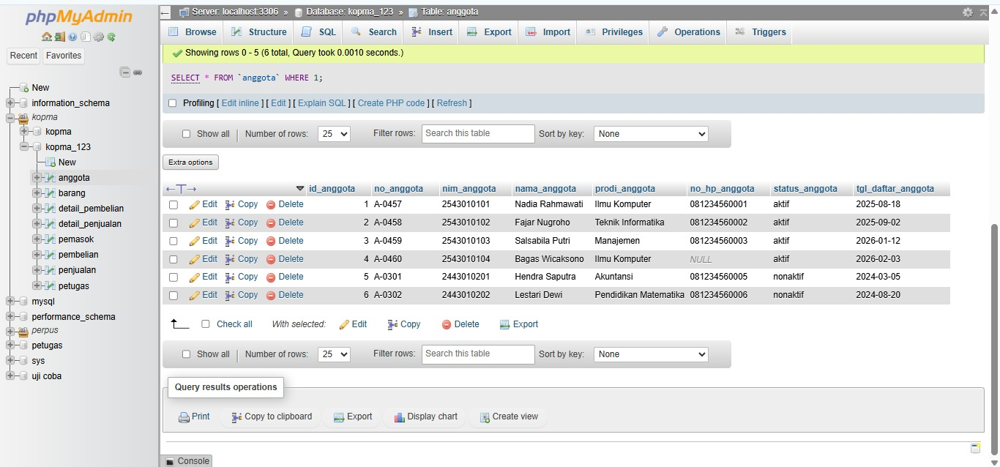
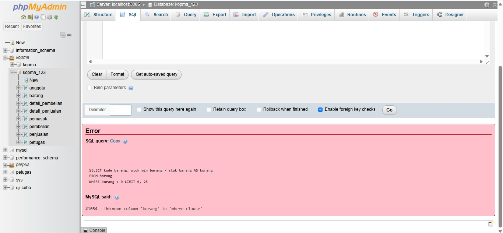
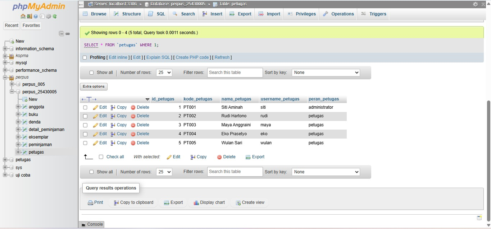
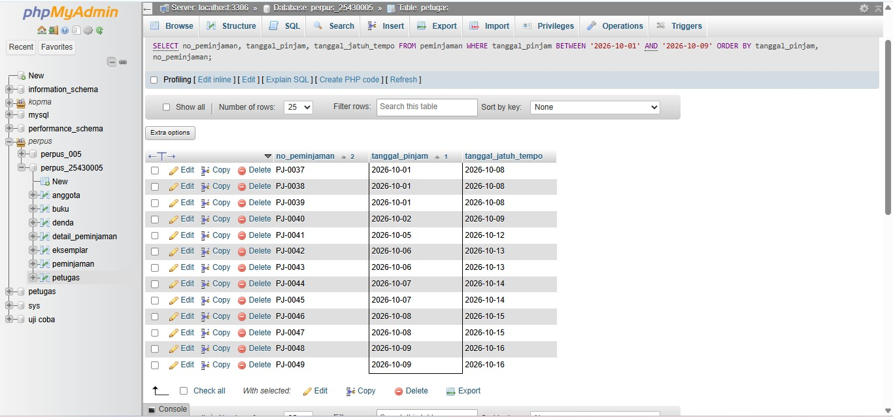
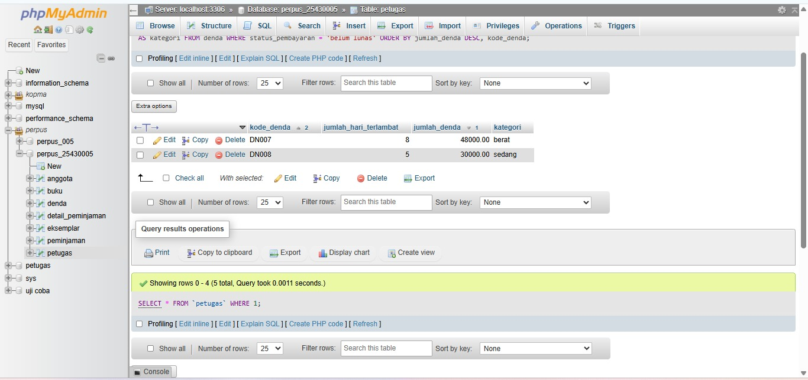
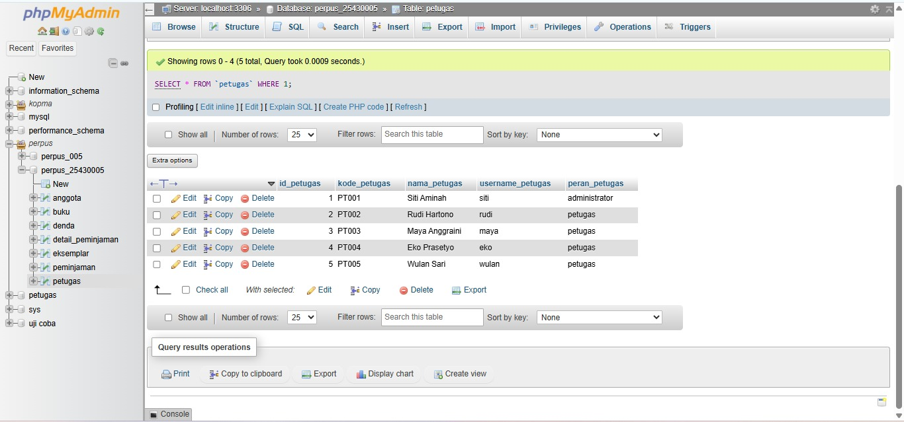

# Laporan Praktikum Basis Data - Pertemuan 7: Menjawab Pertanyaan dengan SELECT dan Fungsi Skalar

- Nama: Putri Nur Rahma Dewi
- NIM: 25430005
- Kelas: A
- Mata Kuliah: Basis Data (Semester 3)

---

## 1. Tujuan

1. Menulis SELECT dengan proyeksi kolom, alias, dan DISTINCT.
2. Menyaring baris dengan operator pembanding, logika, BETWEEN, IN, LIKE, dan IS NULL.
3. Mengurutkan dan membatasi hasil dengan ORDER BY dan LIMIT.
4. Memakai fungsi skalar string, tanggal, numerik, dan kondisional untuk menyajikan hasil sesuai kebutuhan informasi.

## 2. Alat dan Bahan

- XAMPP 8.2.12 (MariaDB 10.4.32) dan phpMyAdmin.
- Basis data `kopma_123` dan `perpus_25430005` berisi data Modul 6.
- Daftar kebutuhan informasi (KI) dari Pertemuan 2.
- Editor teks dan repositori `basisdata-25430005`.

## 3. Ringkasan Langkah Percobaan Kopma

Pada latihan Kopma, saya menulis `p07_kueri_kopma_25430005.sql`. Setiap kueri diberi komentar berisi pertanyaan dan hasil yang diharapkan yang saya tulis sebelum kueri dijalankan, lalu baris *Hasil nyata* diisi setelah dijalankan. Sebelum mulai, data `kopma_123` dikembalikan ke keadaan awal Modul 6 (DDL lalu data) supaya hasil nyata dapat dibandingkan dengan prediksi.

Kueri pertama menjawab KI-03, yaitu barang yang stoknya di bawah stok minimum, dengan alias `kurang` pada kolom hasil hitung dan `ORDER BY kurang DESC`. Tiga kueri penyaringan lain memakai `IN` (kategori ATK atau minuman), `BETWEEN` (nota pada 24 sampai 25 September 2026), dan `IS NULL` (anggota tanpa nomor HP). Kueri berikutnya memakai `LIKE`, `CONCAT`, `DATE_FORMAT`, `IFNULL`, `CASE`, dan `LIMIT` untuk menampilkan label anggota, serta `DATEDIFF` dan `IF` untuk menghitung lama keanggotaan dengan kategori baru atau lama. Terakhir, setiap baris detail nota `PJ-2609-0142` ditampilkan beserta subtotal per barisnya. Skrip lengkap ada di `p07_kueri_kopma_25430005.sql`.

## 4. Milestone Proyek 7: Kueri Perpustakaan

Pada proyek perpustakaan, saya menulis `p07_kueri_25430005.sql` berisi 13 kueri satu tabel yang mendukung kebutuhan informasi (KI) dari Pertemuan 2. Setiap kueri memuat komentar kode KI, pertanyaan dalam bahasa sehari-hari, dan hasil yang diharapkan yang ditulis sebelum kueri dijalankan. Cakupan operatornya lengkap: `LIKE` (P-07), `BETWEEN` (P-04), `IN` (P-08), `IS NULL` (P-09), `CASE` (P-05 dan P-12), fungsi tanggal `DATE_FORMAT` dan `DATEDIFF` (P-10), serta fungsi string `CONCAT` dan `UPPER` (P-11).

KI yang membutuhkan penjumlahan, penghitungan, atau penggabungan tabel belum dapat dijawab dengan satu tabel. KI itu ditandai di akhir berkas untuk dijawab pada Pertemuan 9 sampai 12 (lihat bagian 6.5).

## 5. Bukti Tangkapan Layar

### 5.1 Kopma (`kopma_123`)



*Gambar 1. K-01 (KI-03): barang di bawah stok minimum.*



*Gambar 2. K-03: nota pada 24 dan 25 September 2026 dengan BETWEEN.*



*Gambar 3. K-05: label anggota dengan LIKE, CONCAT, DATE_FORMAT, IFNULL, dan CASE.*



*Gambar 4. K-07: detail nota PJ-2609-0142 beserta subtotal per baris.*



*Gambar 5. K-E2a (Latihan E2): OR tanpa tanda kurung berjalan tanpa galat tetapi hasilnya salah.*



*Gambar 6. Titik Analisis 1: alias `kurang` pada WHERE menghasilkan galat 1054.*

### 5.2 Proyek perpustakaan (`perpus_25430005`)



*Gambar 7. P-01 (KI-01): anggota yang berstatus tidak aktif.*



*Gambar 8. P-04 (KI-07): peminjaman pada 1 sampai 9 Oktober 2026 dengan BETWEEN.*



*Gambar 9. P-05 (KI-06): denda belum lunas dengan kategori keterlambatan memakai CASE.*


*Gambar 10. P-07 (KI-02): judul buku yang mengandung kata Data dengan LIKE.*



*Gambar 11. P-10 (KI-07): format tanggal Indonesia dan lama tenggang dengan DATE_FORMAT dan DATEDIFF.*

### 6.1 Titik Analisis

**Titik Analisis 1.** Mengganti `ORDER BY kurang` menjadi `WHERE kurang > 0` menghasilkan galat `#1054 - Unknown column 'kurang' in 'where clause'`. SELECT ditulis dengan urutan SELECT, FROM, WHERE, ORDER BY, tetapi dievaluasi secara logis dengan urutan FROM, WHERE, SELECT, lalu ORDER BY. Alias `kurang` baru dibuat pada tahap SELECT, sedangkan WHERE dievaluasi lebih dulu sehingga belum mengenal alias itu. ORDER BY dievaluasi sesudah SELECT, jadi alias itu sudah dikenal di sana. Syarat yang setara tanpa alias adalah `WHERE stok_min_barang - stok_barang > 0`, yaitu mengulang ekspresinya di WHERE. Dengan syarat itu kueri berjalan dan hanya menampilkan Roti Cokelat (MKN-001) yang kurang 5.

**Titik Analisis 2.** `WHERE no_hp_anggota = NULL` tidak pernah mengembalikan baris karena perbandingan apa pun dengan NULL, termasuk `= NULL`, menghasilkan UNKNOWN, bukan TRUE, sedangkan WHERE hanya meloloskan baris yang bernilai TRUE. Kueri yang benar memakai `IS NULL`, yang pada data Kopma menampilkan anggota A-0460 (Bagas Wicaksono). NULL berarti nilainya tidak diketahui atau tidak ada, sedangkan string kosong `''` adalah teks yang nilainya ada, tetapi panjangnya nol. Anggota dengan `no_hp_anggota = ''` tidak ditangkap oleh `IS NULL`, dan sebaliknya.

**Titik Analisis 3.** Subtotal per baris dapat dihitung di modul ini karena hanya memakai kolom pada satu baris (`qty_detail_penjualan * harga_satuan_detail_penjualan`). Total nota belum dapat dihitung karena membutuhkan penjumlahan subtotal dari beberapa baris sekaligus menjadi satu nilai. Fitur SQL yang dibutuhkan adalah fungsi agregat `SUM` dengan `GROUP BY`, yang dipelajari pada Pertemuan 9.

### 6.2 Latihan dan Modifikasi

**Latihan 1.** Nama barang ditampilkan dalam huruf kapital dan harga dalam format rupiah dengan `UPPER` dan `FORMAT(harga_jual_barang, 0, 'id_ID')` yang digabung lewat `CONCAT('Rp', ...)`:

```sql
SELECT UPPER(nama_barang) AS nama,
       CONCAT('Rp', FORMAT(harga_jual_barang, 0, 'id_ID')) AS harga
FROM barang
ORDER BY kode_barang;
```

Hasilnya, misalnya PULPEN GEL 0.5 (Rp4.000); BUKU TULIS 58 (Rp6.500); PENGGARIS 30 CM (Rp3.500). Locale `id_ID` membuat pemisah ribuan berupa titik.

**Latihan 2.** Kesalahan semantik yang tetap berjalan adalah syarat OR tanpa tanda kurung. Pertanyaannya: barang berkategori ATK atau minuman yang stoknya kurang dari 40.

```sql
-- salah: AND dievaluasi lebih dulu daripada OR
SELECT kode_barang, kategori_barang, stok_barang FROM barang
WHERE kategori_barang = 'ATK' OR kategori_barang = 'minuman' AND stok_barang < 40;

-- benar
SELECT kode_barang, kategori_barang, stok_barang FROM barang
WHERE (kategori_barang = 'ATK' OR kategori_barang = 'minuman') AND stok_barang < 40;
```

Kueri yang salah berjalan tanpa galat dan menampilkan 4 baris (ATK-001, ATK-002, ATK-003, MNM-002), sebab AND mengikat lebih kuat daripada OR sehingga syarat menjadi "ATK (berapa pun stoknya) atau minuman dengan stok kurang dari 40". Semua ATK ikut tampil walaupun stoknya di atas 40. Kueri yang benar memakai tanda kurung dan hanya menampilkan 1 baris (MNM-002). Kesalahan ini berbahaya karena tidak ada pesan galat yang menandainya.

### 6.3 Pemetaan Kueri Kopma ke Pertanyaan

| Kode | KI | Fitur yang diuji | Hasil yang diharapkan | Hasil nyata | Status |
|---|---|---|---|---|---|
| K-01 | KI-03 | WHERE <, alias, ORDER BY | 1 baris: MKN-001 / Roti Cokelat / 5 / 10 / 5 | Sesuai harapan | Sesuai |
| K-02 | Tambahan | IN | 5 baris: ATK-001; ATK-002; ATK-003; MNM-001; MNM-002 | Sesuai harapan | Sesuai |
| K-03 | KI-01 | BETWEEN pada DATETIME | 3 baris: PJ-2609-0142; PJ-2609-0143; PJ-2609-0144 | Sesuai harapan | Sesuai |
| K-04 | Tambahan | IS NULL | 1 baris: A-0460 / Bagas Wicaksono | Sesuai harapan | Sesuai |
| K-05 | Tambahan | LIKE, CONCAT, DATE_FORMAT, IFNULL, CASE, LIMIT | 5 baris: Bagas Wicaksono (A-0460); Salsabila Putri (A-0459); Fajar Nugroho (A-0458); Nadia Rahmawati (A-0457); Lestari Dewi (A-0302) | Sesuai harapan | Sesuai |
| K-06 | Tambahan | DATEDIFF, IF | 6 baris: A-0460; A-0459; A-0458; A-0457; A-0302 ... | Sesuai harapan | Sesuai |
| K-07 | KI-01 | perhitungan per baris | 3 baris: 1 / 3 / 4000.00 / 12000.00; 2 / 2 / 6500.00 / 13000.00; 3 / 1 / 4000.00 / 4000.00 | Sesuai harapan | Sesuai |
| K-E1 | Latihan E1 | UPPER, FORMAT, CONCAT | 8 baris: PULPEN GEL 0.5 / Rp4.000; BUKU TULIS 58 / Rp6.500; PENGGARIS 30 CM / Rp3.500 ... | Sesuai harapan | Sesuai |
| K-E2a | Latihan E2 | OR tanpa kurung (salah) | 4 baris: ATK-001; ATK-002; ATK-003; MNM-002 | Sesuai harapan | Sesuai |
| K-E2b | Latihan E2 | OR dengan kurung (benar) | 1 baris: MNM-002 | Sesuai harapan | Sesuai |

Semua kueri Kopma menghasilkan hasil yang sama dengan prediksi yang ditulis sebelum kueri dijalankan.

### 6.4 Pemetaan Kueri Proyek ke Kebutuhan Informasi

Kode KI mengikuti urutan kebutuhan informasi pada Pertemuan 2: KI-01 jumlah anggota aktif dan tidak aktif, KI-02 ketersediaan buku, KI-03 daftar buku yang sedang dipinjam, KI-04 lima judul terpopuler, KI-05 anggota yang terlambat, KI-06 total denda per periode, KI-07 jumlah peminjaman dan pengembalian, dan KI-08 daftar petugas berdasarkan peran.

| Kode | KI | Pertanyaan | Operator atau fungsi | Hasil yang diharapkan | Hasil nyata |
|---|---|---|---|---|---|
| P-01 | KI-01 | Siapa saja anggota yang berstatus tidak aktif? | WHERE =, ORDER BY | 2 baris: AG-0011; AG-0012 | Sesuai harapan |
| P-02 | KI-02 | Eksemplar mana yang sekarang tersedia dan berkondisi baik? | AND | 13 baris: EK001; EK002; EK003; EK004 ... | Sesuai harapan |
| P-03 | KI-03 | Eksemplar mana yang masih dipinjam (belum dikembalikan)? | AND, IS NULL | 10 baris: peminjaman 36 (3 eksemplar), 39 (2), 56, 57, 58, dan 59 (2) | Sesuai harapan |
| P-04 | KI-07 | Peminjaman apa saja yang terjadi pada 1 sampai 9 Oktober 2026? | BETWEEN (DATE) | 13 baris: PJ-0037; PJ-0038; PJ-0039; PJ-0040 ... | Sesuai harapan |
| P-05 | KI-06 | Denda apa saja yang belum lunas, dan seberapa berat keterlambatannya? | CASE, ORDER BY dua kolom | 2 baris: DN007; DN008 | Sesuai harapan |
| P-06 | KI-08 | Siapa saja petugas, diurutkan menurut peran? | UPPER, ORDER BY | 5 baris: PT001; PT004; PT003; PT002 ... | Sesuai harapan |
| P-07 | KI-02 | Buku apa saja yang judulnya mengandung kata 'Data'? | LIKE | 3 baris: BK001; BK004; BK006 | Sesuai harapan |
| P-08 | KI-02 | Buku apa saja yang berkategori Pemrograman atau Jaringan? | IN | 4 baris: BK003; BK002; BK004; BK010 | Sesuai harapan |
| P-09 | KI-02 | Buku mana yang belum memiliki nomor ISBN? | IS NULL | 2 baris: BK007; BK008 | Sesuai harapan |
| P-10 | KI-07 | Lima peminjaman pertama: kapan dipinjam (format Indonesia) dan berapa hari tenggangnya? | DATE_FORMAT, DATEDIFF, LIMIT | 5 baris: PJ-0001; PJ-0002; PJ-0003; PJ-0004 ... | Sesuai harapan |
| P-11 | KI-02 | Daftar judul buku dengan penulisnya dalam satu kolom, kategori huruf kapital (5 buku dengan tahun terbit terbaru). | CONCAT, UPPER, LIMIT | 5 baris: Struktur Data dan Algoritma - Maria Lestari; Rekayasa Perangkat Lunak - Fitri Handayani; Basis Data Dasar - Hendra Wijaya; Statistika untuk Sains Data - Ayu Permata ... | Sesuai harapan |
| P-12 | KI-01 | Anggota mana boleh meminjam, dan alamat mana yang masih kosong? | CASE, IFNULL, OR, IS NULL | 4 baris: AG-0005; AG-0009; AG-0011; AG-0012 | Sesuai harapan |
| P-13 | KI-02 | Eksemplar mana (kode di atas EK010) yang rusak atau sedang dipinjam? (OR ditulis dengan tanda kurung) | OR dengan kurung, AND | 8 baris: EK011; EK012; EK014; EK019 ... | Sesuai harapan |

Semua kueri proyek menghasilkan hasil yang sama dengan prediksi yang ditulis sebelum kueri dijalankan.

### 6.5 KI yang Belum Dapat Dijawab dengan Satu Tabel

| KI | Mengapa belum dapat dijawab dengan satu tabel | Diselesaikan di |
|---|---|---|
| KI-01 (jumlah per status) | Perlu `COUNT` dan `GROUP BY` | Pertemuan 9 |
| KI-02 (ketersediaan per judul) | Perlu JOIN tabel eksemplar dan buku | Pertemuan 10 |
| KI-03 (nama buku yang dipinjam) | Perlu JOIN detail_peminjaman, eksemplar, dan buku | Pertemuan 10 |
| KI-04 (lima judul terpopuler) | Perlu JOIN, `COUNT`, `GROUP BY`, `ORDER BY`, dan `LIMIT` | Pertemuan 9 dan 10 |
| KI-05 (anggota terlambat) | Perlu JOIN peminjaman, detail, dan anggota serta pembanding tanggal | Pertemuan 10 |
| KI-06 (total denda per periode) | Perlu `SUM` dan `GROUP BY` | Pertemuan 9 |
| KI-07 (jumlah peminjaman) | Perlu `COUNT` dan `GROUP BY` | Pertemuan 9 |

Kueri satu tabel di berkas ini hanya menjawab sebagian dari KI itu, misalnya menampilkan daftar barisnya, sedangkan jumlah, total, dan nama yang berasal dari tabel lain baru dapat dijawab setelah agregat dan JOIN dipelajari.

### 6.6 Alasan Pemilihan Fungsi Skalar

| Fungsi | Dipakai di | Alasan |
|---|---|---|
| `CONCAT` | K-05, K-E1, P-11 | Menggabungkan beberapa kolom menjadi satu label yang mudah dibaca, misalnya nama dan nomor anggota atau judul dan penulis |
| `UPPER` | K-E1, P-06, P-11 | Menyeragamkan huruf agar kategori dan peran mudah dibandingkan |
| `FORMAT` dengan locale `id_ID` | K-E1 | Menampilkan harga dengan pemisah ribuan titik sesuai kebiasaan Indonesia |
| `DATE_FORMAT` | K-05, P-10 | Menampilkan tanggal dalam format `dd-mm-yyyy` yang lazim di Indonesia |
| `DATEDIFF` | K-06, P-10 | Menghitung selisih hari, yaitu lama keanggotaan dan lama tenggang peminjaman, tanpa menyimpan nilai turunan |
| `IFNULL` | K-05, P-12 | Mengganti nilai kosong (nomor HP atau alamat) dengan tanda `-` agar laporan tidak berisi NULL |
| `IF` dan `CASE` | K-05, K-06, P-05, P-12 | Mengubah nilai menjadi keterangan, misalnya diskon, kategori keanggotaan, dan berat keterlambatan |

Pada K-06, tanggal acuan ditulis tetap (`'2026-10-31'`) dan tidak memakai `CURDATE()`, agar hasil yang diharapkan dapat diprediksi dan diulang kapan saja. Pada K-05, alias tanggal diberi nama `tgl_daftar`, tidak sama dengan nama kolom `tgl_daftar_anggota`, agar `ORDER BY` pasti mengurutkan berdasarkan kolom tanggal asli dan bukan teks hasil `DATE_FORMAT`.

## 7. Masalah yang Dihadapi dan Solusinya

1. **Salah ketik saat menyalin kueri.** Pada K-04, kata `SELECT` tertulis `SSELECT` karena huruf berlebih saat menyalin, sehingga muncul galat `#1064` pada sintaks. Solusinya, kueri disalin ulang dari kata `SELECT` sampai tanda `;`.
2. **Kueri proyek dijalankan di database yang salah.** Kueri proyek harus dijalankan di `perpus_25430005`, bukan `kopma_123`, karena tabel `anggota`, `buku`, dan `peminjaman` yang dimaksud ada di database proyek. Solusinya, database dipilih dulu di panel kiri dan dipastikan dengan `SELECT DATABASE();`.
3. **Data harus kembali ke keadaan awal.** Hasil yang diharapkan dihitung dari data Modul 6, sedangkan uji dan latihan Modul 6 mengubah data. Solusinya, DDL dan data dijalankan ulang sebelum kueri Modul 7 dijalankan.
4. **MySQL sempat berhenti mendadak.** Sebelum Modul 7, phpMyAdmin tidak dapat dibuka karena MySQL pada XAMPP berhenti dengan pesan "MySQL shutdown unexpectedly". Solusinya, folder `mysql\data` dicadangkan lebih dulu, lalu MySQL dijalankan kembali sehingga kedua database tetap dapat dipakai.

## 8. Kesimpulan

Kueri SELECT dengan proyeksi, alias, penyaringan, pengurutan, dan fungsi skalar berhasil menjawab pertanyaan sehari-hari dari data Kopma dan data perpustakaan. Menulis hasil yang diharapkan sebelum kueri dijalankan membantu memeriksa apakah kueri benar-benar menjawab pertanyaan, bukan sekadar berjalan tanpa galat. Dua jenis kesalahan yang ditemukan, yaitu alias pada WHERE (galat 1054) dan OR tanpa tanda kurung (tanpa galat), menunjukkan perbedaan antara kesalahan sintaks yang mudah ditemukan dan kesalahan semantik yang sulit disadari.

Satu tabel hanya cukup untuk KI yang menyangkut penyaringan dan penyajian per baris. KI yang membutuhkan penjumlahan, penghitungan, atau data dari tabel lain ditandai untuk dijawab dengan agregat dan JOIN pada Pertemuan 9 sampai 12.

## 9. Kaitan dengan Pertemuan 8

Pertemuan 8 adalah UTS Proyek Tahap 1, sehingga milestone 1 sampai 7 harus terintegrasi dan dapat dipasang ulang dari skrip: DDL Modul 5, data Modul 6, lalu kueri Modul 7. Kueri milestone ini juga akan diukur kinerjanya pada Buku 2 Modul 6.

---

## 10. Bukti Git

- **Repositori:** https://github.com/putriid990-ai/basisdata-25430005

Riwayat commit yang digunakan sebagai bukti pengerjaan Milestone Proyek 7 adalah sebagai berikut.

| Hash commit | Pesan commit |
|---|---|
| `xxxxxxx` | `p07: kueri kopma` |
| `xxxxxxx` | `p07: kueri proyek perpustakaan` |
| `xxxxxxx` | `p07: tambah bukti dan laporan` |

## Checklist

| Status | Jenis | Yang harus ada |
|---|---|---|
| [√] | Berkas wajib | `p07_kueri_25430005.sql` berisi minimal 10 kueri satu tabel, masing-masing diberi komentar KI dan hasil yang diharapkan |
| [√] | Bukti tangkapan layar | Hasil kueri Kopma dan kueri proyek |
| [√] | Analisis wajib | Pemetaan kueri ke KI; alasan pemilihan fungsi skalar yang dipakai |
